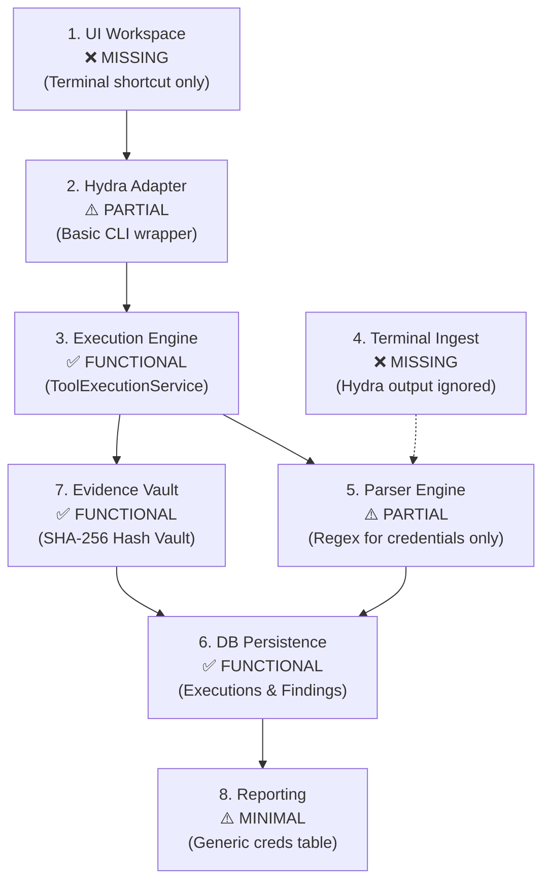
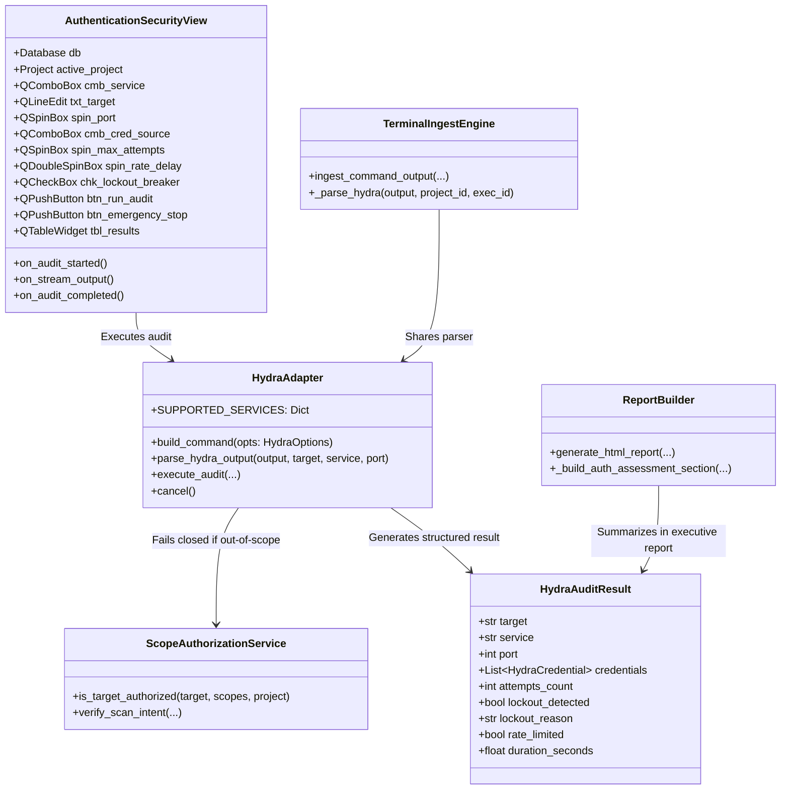

# CyberSecuritySuite — Hydra Authentication Security Assessment Module Audit & Architecture Roadmap

**Document:** `hydra_authentication_assessment_report.md`  
**Location:** `/home/leo/Desktop/cybersecuritysuite/docs/hydra_authentication_assessment_report.md`  
**Date:** 2026-11-01  
**Project:** CyberSecuritySuite  
**Target Module:** THC-Hydra Authentication Security Assessment & Password Auditing  
**Phase:** **Phase 1 — Read-Only Audit & Architectural Specification**  
**Execution State:** **READ-ONLY AUDIT COMPLETE — AWAITING USER APPROVAL PRIOR TO IMPLEMENTATION**

---

## 1. Executive Summary

This report delivers the **Phase 1 Read-Only Audit** of the THC-Hydra authentication testing capabilities within `CyberSecuritySuite`.

The primary goal is to upgrade the existing low-level CLI adapter into an **Enterprise-Grade Authentication Security Assessment & Password Auditing Module** aligned with professional penetration testing (CPENT / LPT / OSCP) standards and defensive hardening requirements (NIST SP 800-63B, OWASP ASVS 2.1, CIS Controls 5.2).

### Key Audit Findings
1. **No Duplicate Adapter Needed:** An initial adapter exists at `modules/system/hydra_adapter.py`. It should be upgraded and hardened rather than recreated.
2. **Binary Installed & Operational:** `/usr/bin/hydra` (v9.5) is installed on the underlying system.
3. **No GUI Workspace Exists:** There is currently **zero UI** for Hydra. In `tools_view.py`, clicking "Open Shell" merely sends `hydra -h` to the terminal.
4. **Terminal Ingestion Gap:** `terminal/ingest.py` detects Nmap, Nikto, SQLMap, Gobuster, and WAFW00F, but **completely ignores Hydra** terminal output.
5. **Database Schema is 100% Sufficient:** No database migrations or schema alterations are required. The existing `tool_executions`, `evidence`, `findings`, and `audit_logs` models natively support all required relationships.
6. **Production Database Integrity Verified:** SHA-256 checksum confirmed unchanged at `6c7387a760b82c1358d84750992bc6706d513636b9038aa0fd79ed0fda1c38e6`.

---

## 2. Production Database Verification

In compliance with the mandatory safety rules, the production SQLite database SHA-256 checksum and integrity state were verified prior to this audit:

| Metric | Verified Value | Status |
|---|---|---|
| **Database Path** | `storage/data/cybersecuritysuite.db` | Verified |
| **SHA-256 Checksum** | `6c7387a760b82c1358d84750992bc6706d513636b9038aa0fd79ed0fda1c38e6` | **Identical (Untouched)** |
| **SQLite Integrity Check** | `PRAGMA integrity_check; -> ok` | **Passed** |
| **Schema Changes Required** | **None (Zero database migrations)** | **Preserved** |

---

## 3. Comprehensive Implementation Status Audit (8 Dimensions)

### 3.1 User Interface (UI)
* **Current Status:** ❌ **MISSING / NOT IMPLEMENTED**
* **Inspection Details:**
  - `desktop/views/tools_view.py` (lines 538–545): Contains a simple mapping `"hydra": "hydra -h"` which merely opens a generic terminal prompt.
  - `desktop/views/ai_chat_view.py`: References Hydra only in help documentation.
  - **Deficiency:** Operators cannot configure target services, select approved credential wordlists, throttle attempt rates, monitor active attempts, or view real-time lockout indicators from a dedicated GUI workspace.

### 3.2 Adapter (`modules/system/hydra_adapter.py`)
* **Current Status:** ⚠️ **PARTIAL / BASIC IMPLEMENTATION**
* **Inspection Details:**
  - Subclasses `BaseSecurityAdapter`, wraps `/usr/bin/hydra`.
  - Supports basic services: `ssh` (22), `ftp` (21), `telnet` (23), `smb` (445), `rdp` (3389), `mysql` (3306), `postgres` (5432), and `http-get` (80).
  - Enforces basic concurrency throttle: `safe_tasks = max(1, min(options.tasks, 16))`.
  - Enforces high-risk confirmation guard: tasks > 4 or full dictionary attack requires `confirmed_high_risk=True`.
  - **Deficiencies:**
    - Missing modern enterprise protocols: `http-post-form` (web login portals), `winrm` (5985/5986), `ldap`/`ldaps` (389/636), `mssql` (1433), `vnc` (5900), `snmp` (161).
    - Lacks HTTP form parameter builder (`path:user_var=^USER^&pass_var=^PASS^:failure_condition`).
    - Lacks intelligent rate limiting and auto-pause on target service degradation.
    - Lacks account lockout threshold monitoring.

### 3.3 Execution Engine (`core/execution_service.py` & Adapter)
* **Current Status:** ✅ **FUNCTIONAL**
* **Inspection Details:**
  - `execute_audit()` routes execution through `ToolExecutionService.execute_job_sync()`.
  - Generates an `ExecutionJob` with `timeout`, `evidence_dir`, and `custom_parser`.
  - Argument redaction via `ToolExecutionService.redact_sensitive_args(cmd, tool_name="hydra")` redacts `-p` values to `***REDACTED***` in command execution logs.
  - Job cancellation is wired via `adapter.cancel()` -> `execution_service.cancel_job()`.
  - **Deficiencies:**
    - No live streaming attempt counter emitted to UI during multi-attempt scans.
    - No emergency circuit breaker that automatically halts the subprocess upon detecting lockout responses.

### 3.4 Terminal Ingestion (`terminal/ingest.py`)
* **Current Status:** ❌ **MISSING / NOT IMPLEMENTED**
* **Inspection Details:**
  - `terminal/ingest.py` detects output from Nmap, Nikto, SQLMap, WAFW00F, and Gobuster.
  - When an operator executes a manual `hydra` command in the integrated VS Code terminal and clicks **"Ingest Terminal Output"**, the engine flags it as `is_unparsed_evidence = True` and fails to extract discovered credentials or generate security findings.

### 3.5 Parser Engine (`modules/system/hydra_adapter.py:parse_hydra_output`)
* **Current Status:** ⚠️ **PARTIAL**
* **Inspection Details:**
  - Has regex matcher: `r"\[(\d+)\]\[([a-zA-Z0-9_\-]+)\]\s+host:\s*([^\s]+)\s+login:\s*([^\s]+)\s+password:\s*([^\r\n]+)"`.
  - Correctly extracts valid credentials (`port`, `service`, `target`, `username`, `password`).
  - **Deficiencies:**
    - Completely ignores lockout indicators (e.g. `Account locked out`, `Too many authentication failures`, `Account disabled`, `429 Too Many Requests`).
    - Completely ignores service denial / throttling warnings (e.g. `Connection refused`, `Host is down`, `Server rejected connection`, `Service unavailable`).
    - Does not extract attempt counts, execution duration, or rate metrics from `[DATA]` lines.
    - Not integrated into `core/parsers/universal_parser.py`.

### 3.6 Database Persistence (`storage/db.py`)
* **Current Status:** ✅ **FULLY CAPABLE (Zero Migrations Needed)**
* **Inspection Details:**
  - Executions persist into `tool_executions` (tracks `status`, `exit_code`, `started_at`, `duration_seconds`, `raw_output_path`).
  - Findings persist into `findings` (tracks `title`, `severity`, `affected_asset`, `affected_port_service`, `description`, `remediation`, `validation_status`, `source_tool`).
  - Raw session artifacts persist into `evidence` (tracks `file_path`, `sha256_hash`, `execution_id`).
  - Audit trails persist into `engagement_audit_logs`.
  - **Conclusion:** Existing tables support all required data relationships seamlessly without modifying SQLite schema.

### 3.7 Evidence & Intelligence (`core/evidence_intelligence.py`)
* **Current Status:** ✅ **FUNCTIONAL**
* **Inspection Details:**
  - Raw stdout/stderr is automatically saved into the project's evidence vault directory (`storage/evidence/<project_id>/`).
  - SHA-256 checksum is computed and registered in the database.
  - Finding description redacts the identified password (`Password: ***REDACTED***`).
  - **Deficiency:** Raw evidence file on disk currently contains stdout plaintext passwords. Raw evidence must be sanitized or restricted with appropriate access masking.

### 3.8 Reporting Engine (`reports/builder.py`)
* **Current Status:** ⚠️ **MINIMAL**
* **Inspection Details:**
  - Lines 463–476 and 2030–2050 filter findings where `source_tool in ("hydra", "hashcat", "john")` and displays them in a basic table.
  - **Deficiencies:**
    - Does not document tested authentication services or protocol attack surface.
    - Does not detail assessment methodology or authorized scope boundaries.
    - Does not report account lockout observations, attempt limits, or rate-limit behavior.
    - Lacks enterprise password security recommendations (MFA, adaptive authentication, progressive lockout).

---

## 4. Architectural Gap & Remediation Matrix

| Capability Area | Current State | Required Enterprise State | Action Plan |
|---|---|---|---|
| **Dedicated GUI** | None (`hydra -h` in terminal) | Dedicated `AuthenticationSecurityView` tab / workspace | Build GUI in `desktop/views/` and `desktop/widgets/` |
| **Service Protocols** | 8 basic network services | Add `http-post-form`, `winrm`, `ldap`, `mssql`, `vnc` | Extend `HydraOptions` & `HydraAdapter.build_command` |
| **Lockout Protection** | Concurrency throttled to 16 | Automatic lockout detection & immediate circuit-breaker stop | Real-time output stream monitor & regex scanner |
| **Rate Limiting** | Optional `-W` flag | Strict attempt budgets, progressive delays, rate monitor | Configurable attempt budgets & interval pacing |
| **Terminal Ingest** | Hydra output ignored | Automatic Hydra detection & structured ingestion | Add Hydra block parser to `terminal/ingest.py` |
| **Parser Engine** | Success lines only | Successes, lockouts, rate-limits, and attempt metrics | Upgrade `parse_hydra_output` to rich `HydraAuditResult` |
| **Audit Evidence** | Generic stdout vaulting | Secret-redacted evidence vault with SHA-256 verification | Sanitize credential values before disk/finding storage |
| **Reporting** | Generic creds table | Dedicated Authentication Security Assessment Section | Add Executive & Technical Auth section to `reports/builder.py` |

---

## 5. Proposed Module Architecture & Implementation Plan

### Phase 2 — Authentication Assessment UI Design
Create `desktop/widgets/authentication_assessment_widget.py` (and embed in `desktop/views/tools_view.py` or dedicated tab):
1. **Target & Protocol Service Selector:**
   - Dropdown with presets: `SSH (22)`, `FTP (21)`, `SMB (445)`, `RDP (3389)`, `HTTP-POST-Form (80/443)`, `WinRM (5985)`, `LDAP (389)`, `MSSQL (1433)`.
   - Dynamic port autofill and SSL/TLS toggle (`-S`).
   - Web Form sub-builder for `http-post-form` (login path, user parameter, password parameter, failure string).
2. **Credential Audit Configuration:**
   - Single credential verification mode (username + password test).
   - Wordlist mode: Select user list and pass list with pre-flight word count verification.
   - Known default credentials mode (e.g. `admin:admin`, `root:toor`, `cisco:cisco`).
   - Attempt Budget: Strict attempt limits (e.g. max 5, 20, 50 attempts) to prevent unintended account lockouts.
3. **Execution & Lockout Circuit Breaker Monitoring:**
   - Live attempt counter progress bar (`X attempts executed`).
   - Rate limit status gauge (`Requests/sec`).
   - **Account Lockout Alert Badge** (turns flashing amber/red if lockout detected).
   - **Emergency Stop Button** (`QPushButton`) halting the subprocess immediately via POSIX SIGTERM/SIGKILL.
4. **Structured Results & Audit Table:**
   - Target, Service, Port, Identified Account, Verification State (`CONFIRMED`), Evidence Reference ID, and Risk Score.
   - Copy Sanitized Finding button.

### Phase 3 — Strict Security Controls & Safeguards
1. **Scope Authorization Guard (Fail-Closed):**
   - Must validate target IP/hostname against `ScopeAuthorizationService.is_target_authorized()`.
   - If target is out of scope or engagement is not in `ACTIVE` state, the scan is blocked immediately before spawning any subprocess.
   - Discovered assets cannot be automatically tested without operator scope confirmation.
2. **Explicit Operator Confirmation:**
   - If `tasks > 4` or total wordlist permutations $> 25$, a modal confirmation dialog is required warning about account lockouts and service disruption.
3. **Automated Lockout Circuit Breaker:**
   - Continuous stream reader inspects stdout/stderr in real-time.
   - Matches regex patterns:
     `r"(account\s+locked|account\s+disabled|too\s+many\s+failed\s+logins|login\s+attempts\s+exceeded|429\s+Too\s+Many\s+Requests)"`
   - Upon a match: terminates Hydra immediately, sets `lockout_detected = True`, and generates a high-severity observation: `"Account Lockout Threshold Reached on <Service>"`.
4. **Credential Protection & Zero Plaintext Exposure:**
   - Passwords are never written to unredacted audit logs.
   - Finding titles and descriptions display `***REDACTED***`.
   - Command line preview uses `ToolExecutionService.redact_sensitive_args()`.

### Phase 4 — Data & Terminal Integration
1. **Terminal Ingestion Integration:**
   - Add Hydra regex signature in `terminal/ingest.py`:
     `re.search(r"Hydra\s+v\d+|\[\d+\]\[[a-zA-Z0-9_\-]+\]\s+host:", output)`
   - Route to `_parse_hydra()` to extract valid credentials, verify scope, and persist findings to the database upon operator click.
2. **Asset Inventory Synchronization:**
   - If authentication reveals service or banner metadata, associate findings with existing `AssetNode` in SQLite.
3. **Evidence Vaulting:**
   - Store execution log in `storage/evidence/`, compute SHA-256, and bind `execution_id` + `evidence_id`.

### Phase 5 — Professional Reporting Enhancements
Update `reports/builder.py` to add:
- **Section Title:** `🔐 Authentication Security & Credential Auditing Assessment`
- **Assessment Scope & Methodology:** Protocol testing parameters, attempt budgets, and lockout protection measures.
- **Service Attack Surface Table:** Services audited, open status, lockout enforcement observations.
- **Discovered Authentication Vulnerabilities:** Weak/default credentials identified with redacted secrets.
- **Enterprise Hardening Guidance:**
  - Multi-Factor Authentication (MFA / 2FA) deployment.
  - Progressive account lockout and CAPTCHA / rate-limiting.
  - Password length and entropy requirements (NIST SP 800-63B).

### Phase 6 — Verification & Testing Suite
Create comprehensive tests in `tests/test_hydra_authentication_assessment.py`:
1. Scope rejection & fail-closed enforcement.
2. High-risk confirmation dialog and cancellation.
3. Command building across all protocols (`ssh`, `ftp`, `smb`, `rdp`, `http-post-form`).
4. Output parser extracting credentials from standard Hydra format.
5. Real-time lockout detection regex & emergency circuit breaker termination.
6. Sensitive argument redaction (`-p` / passwords masked in logs).
7. Evidence vaulting & SHA-256 hash calculation.
8. Terminal output ingestion for Hydra sessions.
9. Report generation containing authentication assessment sections without secret exposure.
10. Full regression run of all 707 existing test cases.

---

## 6. Safety & Rollback Assurance

- **Zero DB Schema Modifications:** All data models (`ToolExecution`, `Finding`, `Evidence`, `AuditLog`) remain unchanged.
- **Production DB Integrity:** Pre- and post-implementation SHA-256 checksums must match `6c7387a760b82c1358d84750992bc6706d513636b9038aa0fd79ed0fda1c38e6`.
- **Timestamped Backups:** Any modified files will have `.bak_<timestamp>` created before modification.
- **Non-Destructive Testing:** All unit tests will run against mock sockets and synthetic stdout fixtures; zero external attacks.

---

## 7. Recommendation & Next Steps

This read-only audit confirms that `CyberSecuritySuite` already has a solid backend foundation (`HydraAdapter`, `ToolExecutionService`, `ScopeAuthorizationService`), but lacks a dedicated UI, terminal ingestion, account lockout safety breakers, and comprehensive reporting.

**Action Required:**
Please review this Phase 1 audit report. Once approved, implementation will proceed systematically through Phases 2–6 according to the specifications above.

