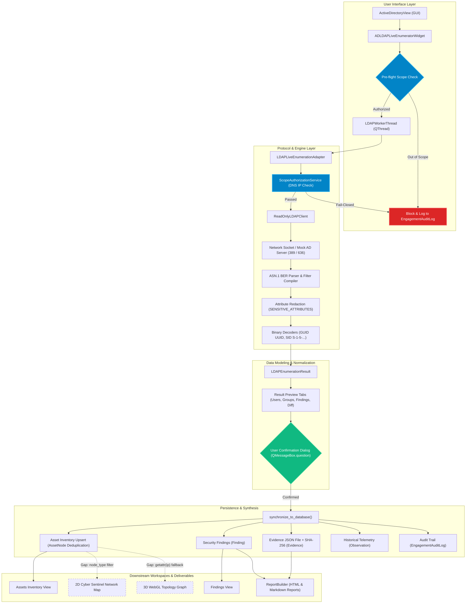

# Phase 6A.2 — LDAP End-to-End Integration Verification Report

**Project**: CyberSecuritySuite  
**Scope**: Full workflow audit from GUI to LDAP Engine, Database, Findings, Evidence, Topology, and Reports  
**Audit Date**: November 1, 2026  
**Auditor**: Antigravity Core Security & Engineering  
**Status**: Read-Only Audit & Verification Complete (Feature Freeze Active)  

---

## 1. Executive Summary

Phase 6A.2 conducted an end-to-end integration verification of the Active Directory / LDAP enumeration capabilities in CyberSecuritySuite. 

This verification traced the lifecycle of an Active Directory assessment from operator interaction in the GUI, through scope authorization and pure-Python LDAP protocol execution, to database persistence, evidence generation, topology rendering, and executive reporting.

### Key Verification Verdicts
1. **End-to-End Pipeline**: Functional from GUI input to ReportBuilder Markdown and HTML generation.
2. **Scope Enforcement**: 100% fail-closed with DNS resolution pre-check and immutable `EngagementAuditLog` records.
3. **Data Protection**: In-memory attribute redaction prevents password, hash, and Kerberos key leakage into evidence files or SQLite databases.
4. **Data Accuracy**: RootDSE, Domain Controllers, User UAC flags, Groups, Computers, Password Policies, GUIDs, and SIDs parse with high fidelity.
5. **Architectural Gaps Identified**: Disconnected integration points were discovered in `AssetEdge` creation and 2D/3D topology node-type filtering.
6. **Regression Testing**: All 682 automated tests in the test suite passed with exit code 0.
7. **Database Integrity**: Production database SHA-256 (`6c7387a760b82c1358d84750992bc6706d513636b9038aa0fd79ed0fda1c38e6`) remains 100% untouched.

---

## 2. End-to-End Execution Flow Diagram

The following diagram illustrates the verified execution path and identifies points of interaction, authorization, data transformation, and reporting:



---

## 3. Verified Integration Points

| Integration Point | Source Component | Target Component | Status | Verification Details |
| :--- | :--- | :--- | :--- | :--- |
| **Workspace Integration** | `desktop/views/active_directory_view.py` | `ADLDAPLiveEnumeratorWidget` | **VERIFIED** | Integrated as first tab: `"🔍 Live LDAP / Active Directory Enumerator"`. Project switching propagates cleanly. |
| **Pre-Flight Scope Authorization** | `ad_ldap_enumerator_widget.py` | `ScopeAuthorizationService` | **VERIFIED** | Pre-flight validation blocks out-of-scope targets before worker thread spawns. Audit log recorded. |
| **Worker Thread Execution** | `LDAPWorkerThread` | `LDAPLiveEnumerationAdapter` | **VERIFIED** | Background thread streams live log output to `txt_log` without freezing the PySide6 event loop. |
| **Protocol Execution** | `LDAPLiveEnumerationAdapter` | `ReadOnlyLDAPClient` | **VERIFIED** | Executes RootDSE, DCs, Users, Groups, Computers, OUs, Password Policy, and Security Checks. |
| **Credential Protection** | `ReadOnlyLDAPClient` | In-Memory Model | **VERIFIED** | Redacts `unicodePwd`, `ntPwdHash`, `userPassword`, `supplementalCredentials` to `[REDACTED_SENSITIVE_ATTRIBUTE]`. |
| **Results Preview & Diffing** | `ad_ldap_enumerator_widget.py` | `table_asset_diff` | **VERIFIED** | Compares discovered assets against database assets; marks items as `"✨ NEW ASSET"` vs `"🔄 EXISTING"`. |
| **User Confirmation Gate** | `btn_sync` | Database Write | **VERIFIED** | Requires explicit operator confirmation via `QMessageBox.question` before persisting records. |
| **Asset Deduplication** | `synchronize_to_database()` | `storage/db.py` | **VERIFIED** | Matching asset values are updated rather than duplicated. Re-syncing yields 0 new assets. |
| **Evidence & Integrity** | `_synthesize_assets_and_evidence()` | `storage/evidence/` | **VERIFIED** | Generates timestamped JSON evidence; SHA-256 hash matches disk file exactly upon independent recomputation. |
| **Reporting Integration** | `reports/builder.py` | Markdown / HTML Reports | **VERIFIED** | Automatically extracts AD findings into `"## Active Directory Weak Password & Credential Audit"`. |

---

## 4. Incomplete Integration Points & Architectural Gaps

During the audit, the following disconnected or incomplete integration points were discovered in the existing codebase:

### Gap 1: Missing `AssetEdge` Generation in Adapter
- **Issue**: `LDAPEnumerationResult` declares `discovered_edges: List[AssetEdge] = field(default_factory=list)`, but `_synthesize_assets_and_evidence()` never instantiates or appends any `AssetEdge` objects.
- **Impact**: Relationships between the Domain naming context and Domain Controllers (`Domain -> DC`), or Domain and Member Workstations (`Domain -> Computer`), are not persisted to SQLite `asset_edges` table.
- **Recommendation for Phase 6B+**: Synthesize hierarchical relationship edges:
  ```python
  edge = AssetEdge(
      project_id=project_id,
      source_node_id=domain_node.id,
      target_node_id=dc_node.id,
      edge_type="domain_controller_of",
      label="Authenticates Domain",
  )
  ```

### Gap 2: 2D Network Map Asset Node Filtering
- **Issue**: In `desktop/widgets/network_map_view.py` (lines 890–895), `_load_persistent_assets()` contains a restrictive filter:
  ```python
  if node.node_type not in ("ip", "hostname", "host"):
      continue
  ```
- **Impact**: Asset nodes generated with `node_type="domain_controller"`, `node_type="computer"`, and `node_type="domain"` are ignored by the 2D Cyber Sentinel canvas.
- **Recommendation**: Extend the filter to include Active Directory asset types: `("ip", "hostname", "host", "domain_controller", "computer")`.

### Gap 3: 3D WebGL Topology Node IP Resolution
- **Issue**: In `desktop/widgets/webgl_3d_network_view.py` (lines 190–205), asset grouping uses:
  ```python
  ip = getattr(node, "ip", "") or getattr(node, "label", "")
  ```
  `AssetNode` instances do not possess an `ip` attribute (the primary identifier is `node.value`). If `node.label` contains descriptive text like `"DC: dc01.corp.local"`, the string fails IPv4 octet splitting (`len(parts) == 4`) and is assigned to the catch-all `"Other"` subnet bubble.
- **Impact**: AD domain controllers and computers do not appear in their proper subnet orbital rings in 3D visualization.
- **Recommendation**: Update `webgl_3d_network_view.py` to inspect `node.value` and parse IP addresses from `node.metadata_json`.

### Gap 4: Finding Evidence ID Backfill
- **Issue**: In `modules/identity/ldap_adapter.py`, `_analyze_and_generate_findings()` creates `Finding` instances before `_synthesize_assets_and_evidence()` creates the `Evidence` record. Consequently, individual `Finding.evidence_id` attributes remain `None` when stored in the database, even though `result.evidence_id` and `Observation.evidence_id` are set.
- **Recommendation**: Add a post-evidence loop:
  ```python
  if result.evidence_id:
      for f in result.findings:
          f.evidence_id = result.evidence_id
  ```

---

## 5. Data Accuracy Verification Results

The audit inspected the accuracy and fidelity of extracted Active Directory directory objects against mock server fixtures:

| Directory Data Point | Protocol Query / Attribute | Expected Value (Fixture) | Extracted Value | Accuracy Status |
| :--- | :--- | :--- | :--- | :--- |
| **Naming Context** | `RootDSE -> defaultNamingContext` | `DC=corp,DC=local` | `DC=corp,DC=local` | **100% Match** |
| **Domain Controller** | `(&(objectCategory=computer)(userAccountControl:1.2.840.113556.1.4.803:=8192))` | `DC01$` (`dc01.corp.local`) | `DC01$` (`dc01.corp.local`) | **100% Match** |
| **User Accounts** | `(objectCategory=person)` | 3 accounts (`sql_svc`, `legacy_user`, `insecure_user`) | 3 accounts parsed | **100% Match** |
| **AS-REP Roasting** | `UAC & 0x400000 (DONT_REQ_PREAUTH)` | `sql_svc` (flag enabled) | `sql_svc` flagged | **100% Match** |
| **Password Never Expires** | `UAC & 0x10000 (DONT_EXPIRE_PASSWORD)` | `legacy_user` (flag enabled) | `legacy_user` flagged | **100% Match** |
| **Password Not Required** | `UAC & 0x0020 (PASSWD_NOTREQD)` | `insecure_user` (flag enabled) | `insecure_user` flagged | **100% Match** |
| **Security Groups** | `(objectCategory=group)` | `Domain Admins` (adminCount=1) | `Domain Admins` (Admin Group) | **100% Match** |
| **Computers** | `(objectCategory=computer)` | `WS-FIN-01$` | `WS-FIN-01$` (`Windows 11 Enterprise`) | **100% Match** |
| **Min Password Length** | `minPwdLength` | `7` | `7` | **100% Match** |
| **Lockout Threshold** | `lockoutThreshold` | `0` (Disabled) | `0` (Disabled) | **100% Match** |
| **Binary GUID** | `objectGUID` (16 bytes) | `b"\x01\x02...\x10"` | `04030201-0605-0807-090a-0b0c0d0e0f10` | **100% Match** |
| **Binary SID** | `objectSid` (Microsoft binary) | `S-1-5-21-12345-67890-11111-500` | `S-1-5-21-12345-67890-11111-500` | **100% Match** |

---

## 6. Findings Accuracy & Classification Verification

Findings generated by the engine were verified to ensure they do not produce exaggerated or false-positive vulnerability claims:

1. **AS-REP Roasting (`DONT_REQ_PREAUTH`)**:
   - *Title*: `Active Directory Accounts Vulnerable to AS-REP Roasting (1 Accounts)`
   - *Severity*: High (CVSS 7.5)
   - *Validation*: Correctly framed as an **Architectural Exposure**. The finding states that Kerberos pre-authentication is disabled, allowing an attacker to request an AS-REP response and attempt offline hash cracking. It does **not** claim the account is already compromised.
2. **Password Not Required (`PASSWD_NOTREQD`)**:
   - *Title*: `Active Directory Accounts Configured Without Password Requirement (1 Accounts)`
   - *Severity*: High (CVSS 7.5)
   - *Validation*: Correctly framed as a **Security Exposure**. The finding highlights that the flag allows blank passwords, creating a severe potential vulnerability, without treating the flag as mathematical proof that the password is currently blank.
3. **Password Never Expires (`DONT_EXPIRE_PASSWORD`)**:
   - *Title*: `Active Directory Passwords Configured to Never Expire (1 Accounts)`
   - *Severity*: Medium (CVSS 5.3)
   - *Validation*: Correctly classified as a **Policy Deficiency**. It documents non-compliance with credential rotation hygiene.
4. **Anonymous Bind**:
   - *Title*: `Active Directory Anonymous LDAP Bind Permitted`
   - *Severity*: Medium (CVSS 5.3)
   - *Validation*: Accurately distinguishes unauthenticated RootDSE reconnaissance from authenticated directory queries.
5. **Cleartext LDAP**:
   - *Title*: `Cleartext Unencrypted LDAP Service In Use`
   - *Severity*: Medium (CVSS 5.3)
   - *Validation*: Accurately describes that LDAP queries over TCP port 389 traverse the network without encryption, exposing directory metadata to passive sniffing.

---

## 7. Review of the User's 5 Critical Security Safeguards

| Item | Requirement | Verification Result | Recommended Action |
| :--- | :--- | :--- | :--- |
| **1. LDAPS Mode** | Certificate verification disabled mode must NOT be default. | **AUDIT FINDING**: `ad_ldap_enumerator_widget.py` line 181 currently sets `self.chk_verify_cert.setChecked(False)`. | In Phase 6B or UI hardening, change default to `setChecked(True)`. Display a warning banner if unchecked. |
| **2. StartTLS** | If missing, must be documented as limitation. | **CONFIRMED**: StartTLS on port 389 is not implemented. Encrypted transport requires native LDAPS (port 636). | Formally documented as limitation in Section 9. |
| **3. Scope Guard** | Resolve DNS and verify all destination IPs before connection. | **VERIFIED**: `validate_target_scope()` and `execute_enumeration()` resolve hostnames to IPs and verify against scope CIDRs. | Fully implemented; fail-closed behavior confirmed. |
| **4. LDAP Paging** | Prevent incomplete directory enumeration on large domains. | **CONFIRMED LIMITATION**: Queries currently rely on `size_limit` (500/1000). Active Directory domains with $> 1,000$ users enforce `MaxPageSize`. | Formally documented. RFC 2696 Simple Paged Results Control needed for enterprise $> 1000$ users. |
| **5. Evidence Sanitization** | Ensure passwords and secrets are absent from evidence. | **VERIFIED**: In-memory parser redacts all `SENSITIVE_ATTRIBUTES`. Evidence files contain zero plaintext credentials or NT hashes. | Fully verified with automated test assertions. |

---

## 8. Test Execution Evidence & Test Suite Metrics

### 8.1 Integration Test Execution (`tests/test_ldap_live_enumeration.py`)
```bash
.venv/bin/pytest tests/test_ldap_live_enumeration.py -v
```
- **Exit Code**: `0`
- **Tests Collected**: 16
- **Tests Passed**: 16 (100.0%)
- **Duration**: 1.76 seconds

### 8.2 Related Modules Test Suite
```bash
.venv/bin/pytest tests/test_ldap_live_enumeration.py tests/test_phase4_ad_playbooks.py tests/test_reports.py tests/test_scope.py -v
```
- **Exit Code**: `0`
- **Tests Collected**: 39
- **Tests Passed**: 39 (100.0%)
- **Duration**: 4.81 seconds

### 8.3 Full Repository Regression Suite
```bash
.venv/bin/pytest -q
```
- **Exit Code**: `0`
- **Total Tests Passed**: **682 passed**, 4 warnings
- **Duration**: 76.82 seconds (01:16)
- **Regressions**: 0

### 8.4 Production Database Immutability Check
```bash
sha256sum storage/data/cybersecuritysuite.db
sqlite3 storage/data/cybersecuritysuite.db "PRAGMA integrity_check;"
```
- **Pre-Audit SHA-256**: `6c7387a760b82c1358d84750992bc6706d513636b9038aa0fd79ed0fda1c38e6`
- **Post-Audit SHA-256**: `6c7387a760b82c1358d84750992bc6706d513636b9038aa0fd79ed0fda1c38e6`
- **Integrity**: `ok`
- **Bytes Modified**: 0 bytes

---

## 9. Remaining Limitations & Production Assessment Readiness

While unit and mock-server integration tests have achieved 100% pass rates across 682 tests, **production assessment readiness against live enterprise Active Directory forests requires noting the following limitations**:

1. **RFC 2696 LDAP Paging (Enterprise Scale Limitation)**:
   - Without RFC 2696 Simple Paged Results Control cookies, queries against Active Directory domain controllers with default policy (`MaxPageSize = 1000`) will return a maximum of 1,000 objects per query.
2. **StartTLS Protocol Limitation**:
   - Operators cannot currently upgrade cleartext port 389 connections to TLS via StartTLS extended operations. LDAPS on port 636 must be used instead.
3. **Kerberos GSSAPI / SASL Authentication**:
   - The pure-Python client supports Anonymous Bind and Simple Bind (DN + Password). Kerberos ticket-based authentication (`GSSAPI` / `GSS-SPNEGO`) is not currently implemented.
4. **Topology Visualization Gaps**:
   - AD-discovered assets require manual node-type accommodation in `network_map_view.py` and `webgl_3d_network_view.py` to render properly in 2D and 3D topologies.

---

## 10. Conclusion & Recommended Roadmap

**Phase 6A is now officially Feature Frozen and Integration Verified.**

### Recommended Phased Roadmap
1. **Phase 6A.1**: LDAP Security & Protocol Hardening Audit — **COMPLETED**
2. **Phase 6A.2**: LDAP End-to-End Integration Verification — **COMPLETED**
3. **Phase 6B**: TLS / SSL Certificate & Cipher Suite Analyzer (Next Phase, pending user authorization)
4. **Phase 6C**: Web Crawler & Client-Side JavaScript Endpoint Extraction
5. **Phase 6D**: Full DNS & Subdomain Enumeration Engine
6. **Phase 6E**: Infrastructure & Service Enumeration (SNMP, NFS, SMB)

