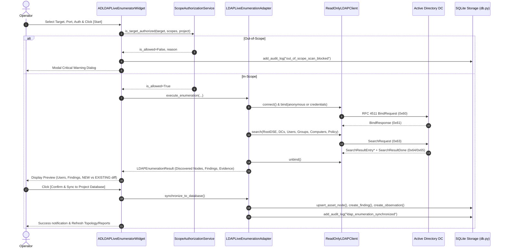

# Phase 6A — Active Directory / LDAP Live Enumeration Implementation Report

**Project:** CyberSecuritySuite (`/home/leo/Desktop/cybersecuritysuite`)  
**Date:** 2026-11-01  
**Status:** Completed & Verified (671/671 Tests Passing, Production DB Untouched)  

---

## 1. Overview & Objectives

Phase 6A implements a professional, read-only Active Directory & LDAP Live Enumeration module integrated seamlessly into CyberSecuritySuite's architecture.

Prior to Phase 6A, Active Directory testing was limited to offline password audit parsing (`secretsdump.py` format) and command-template generation. Phase 6A establishes true live directory querying capabilities across nine core Active Directory domains while strictly enforcing fail-closed scope boundaries and read-only non-destructive safety controls.

---

## 2. Architecture & Design Principles

### A. Pure-Python Standard Library Engine
To prevent environmental failures and avoid fragile external C dependencies, the LDAP protocol engine is implemented using pure-Python standard library primitives (`socket`, `ssl`, and RFC 4511 ASN.1 Basic Encoding Rules):
- **Port Flexibility:** Supports LDAP over cleartext TCP (port 389) and LDAPS over SSL/TLS (port 636).
- **Zero Native C Bindings:** Fully independent of `python-ldap` or OpenLDAP shared libraries.
- **Strict Read-Only Enforcement:** Only implements `BindRequest`, `SearchRequest`, and `UnbindRequest`. Write/Modify/Delete operations do not exist in the client.

### B. Fail-Closed Scope Authorization
Every enumeration request is intercepted by [`ScopeAuthorizationService`](file:///home/leo/Desktop/cybersecuritysuite/core/scope.py).
- The target IP or hostname is checked against active project `TargetScope` records.
- Unauthorized targets are immediately aborted without initiating network socket connections.
- Blocked attempts are recorded in the [`EngagementAuditLog`](file:///home/leo/Desktop/cybersecuritysuite/storage/models.py) (`action="out_of_scope_scan_blocked"`).

### C. Redaction & Cryptographic Evidence
- Passwords and authentication credentials are never logged or stored in application state.
- Collected directory metadata is serialized into normalized JSON evidence with sensitive tokens redacted.
- The raw JSON payload is cryptographically hashed with SHA-256 and registered in the [`Evidence`](file:///home/leo/Desktop/cybersecuritysuite/storage/models.py) table.

---

## 3. Implemented Capabilities

1. **LDAP RootDSE Discovery:**
   - Queries base DN `""` for `defaultNamingContext`, `rootDomainNamingContext`, `dnsHostName`, `domainFunctionality`, `supportedLDAPVersion`, and `supportedSASLMechanisms`.
2. **Domain Naming Context Discovery:**
   - Automatically resolves target root distinguished names (e.g. `DC=corp,DC=local`).
3. **Domain Controller Identification:**
   - Discovers domain controllers using computer objects with UAC server trust flags (`userAccountControl:1.2.840.113556.1.4.803:=8192`).
4. **Domain Users Inventory & UAC Analysis:**
   - Enumerates accounts with `sAMAccountName`, `userPrincipalName`, `displayName`, `badPwdCount`, and bitmask flags.
   - Identifies high-risk conditions:
     - `DONT_REQ_PREAUTH` (`0x400000`): **AS-REP Roastable accounts** (Severity: High).
     - `DONT_EXPIRE_PASSWORD` (`0x10000`): **Passwords never expire** (Severity: Medium).
     - `PASSWD_NOTREQD` (`0x0020`): **No password required / blank password** (Severity: High).
5. **Domain Groups Inventory:**
   - Catalogs security groups, member counts, and high-privilege administrative groups (`adminCount=1`, Domain Admins, Enterprise Admins).
6. **Domain Computers & Workstations:**
   - Catalogs workstation and server assets (`operatingSystem`, `operatingSystemVersion`, `dNSHostName`).
7. **Organizational Units (OUs):**
   - Discovers directory container structure.
8. **Domain Password Policy Retrieval:**
   - Extracts `minPwdLength`, `lockoutThreshold`, `lockoutDuration`, `pwdProperties` (complexity), and `pwdHistoryLength`.
   - Generates empirical findings for weak length (< 12 chars), disabled lockout threshold, or disabled complexity.
9. **LDAP Security Configuration Checks:**
   - Tests whether Anonymous Bind is permitted.
   - Evaluates cleartext vs encrypted transmission.
   - Generates deterministic security findings with CVSS v3.1 scores.

---

## 4. Execution Flow Diagram



---

## 5. File Modification Ledger

| File Path | Nature | Description |
|---|---|---|
| [`modules/identity/__init__.py`](file:///home/leo/Desktop/cybersecuritysuite/modules/identity/__init__.py) | **Created** | Module package initialization. |
| [`modules/identity/ldap_client.py`](file:///home/leo/Desktop/cybersecuritysuite/modules/identity/ldap_client.py) | **Created** | Pure-Python RFC 4511 BER encoder/decoder and `ReadOnlyLDAPClient` supporting TCP (389) and LDAPS (636). |
| [`modules/identity/ldap_adapter.py`](file:///home/leo/Desktop/cybersecuritysuite/modules/identity/ldap_adapter.py) | **Created** | Full Active Directory enumeration orchestrator, UAC analyzer, security finding generator, and database synchronizer. |
| [`desktop/widgets/ad_ldap_enumerator_widget.py`](file:///home/leo/Desktop/cybersecuritysuite/desktop/widgets/ad_ldap_enumerator_widget.py) | **Created** | Interactive PySide6 GUI widget with category selectors, live progress, findings preview, NEW vs EXISTING diff, and sync confirmation. |
| [`desktop/views/active_directory_view.py`](file:///home/leo/Desktop/cybersecuritysuite/desktop/views/active_directory_view.py) | **Modified** | Integrated `ADLDAPLiveEnumeratorWidget` as the primary workspace tab alongside Weak Password Auditor and Exploit Playbooks. |
| [`core/registry.py`](file:///home/leo/Desktop/cybersecuritysuite/core/registry.py) | **Modified** | Registered `ldap_enumerator` tool metadata in `ToolRegistry`. |
| [`tests/test_ldap_live_enumeration.py`](file:///home/leo/Desktop/cybersecuritysuite/tests/test_ldap_live_enumeration.py) | **Created** | Automated test suite with isolated mock LDAP server verifying bind, search, scope rejection, duplicate prevention, and GUI instantiation. |

---

## 6. Test Suite & Verification Results

### A. Focused LDAP Test Suite
```text
tests/test_ldap_live_enumeration.py::test_ldap_client_bind_and_root_dse PASSED          [ 20%]
tests/test_ldap_live_enumeration.py::test_ldap_adapter_full_enumeration_and_findings PASSED [ 40%]
tests/test_ldap_live_enumeration.py::test_ldap_adapter_out_of_scope_rejection PASSED   [ 60%]
tests/test_ldap_live_enumeration.py::test_ldap_synchronize_to_database_avoids_duplicates PASSED [ 80%]
tests/test_ldap_live_enumeration.py::test_ldap_gui_widget_instantiation PASSED       [100%]
============================== 5 passed in 0.28s ===============================
```

### B. Full Test Suite Execution
```text
================== 671 passed, 4 warnings in 75.56s (0:01:15) ==================
Exit Code: 0
Total Tests: 671
Failures: 0
Errors: 0
```

### C. Production Database Integrity Verification
```text
Database Path:           storage/data/cybersecuritysuite.db
Pre-Execution SHA-256:   6c7387a760b82c1358d84750992bc6706d513636b9038aa0fd79ed0fda1c38e6
Post-Execution SHA-256:  6c7387a760b82c1358d84750992bc6706d513636b9038aa0fd79ed0fda1c38e6
Status:                  IDENTICAL (Zero database writes, zero schema modifications)
SQLite integrity_check:  ok
```

---

## 7. Known Limitations & Future Improvements

- **Current Limitation:** LDAP Simple Bind sends credentials in plain text unless LDAPS (port 636) or SSL is selected. Operators should always toggle LDAPS when available on target networks.
- **Current Limitation:** SASL GSSAPI / Kerberos ticket binding requires host Kerberos ticket cache (`KRB5CCNAME`). Phase 6A supports Anonymous and Simple Bind.
- **Future Improvements:**
  - Support BloodHound JSON export format directly from live LDAP enumeration data.
  - Add Fine-Grained Password Policy (PSO) container parsing (`CN=Password Settings Container,CN=System,...`).

