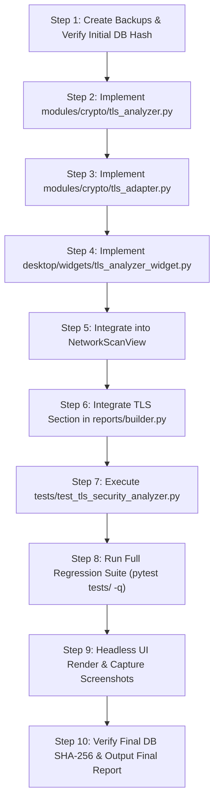

# Phase 6B — TLS/SSL Certificate & Cipher Suite Analyzer Implementation Plan

**Project:** CyberSecuritySuite  
**Workspace:** `/home/leo/Desktop/cybersecuritysuite`  
**Author:** Antigravity  
**Date:** November 1, 2026  
**Status:** PROPOSED & READY FOR IMPLEMENTATION  

---

## 1. Executive Summary & Pre-Implementation Audit

Phase 6B introduces a professional, read-only **TLS/SSL Security Assessment Module** into the CyberSecuritySuite platform. The module evaluates transport layer security posture by inspecting X.509 certificate validity and parameters, testing support for legacy/deprecated protocol versions (SSLv2, SSLv3, TLS 1.0, TLS 1.1) and modern protocols (TLS 1.2, TLS 1.3), auditing cipher suite strength (NULL, EXPORT, Anonymous, RC4, 3DES, CBC, and Forward Secrecy), generating cryptographic evidence with SHA-256 provenance, persisting deduplicated findings, and formatting results into the executive report builder and desktop UI.

### Pre-Implementation Codebase Audit Findings

| Component | Current State | Reusability in Phase 6B |
|---|---|---|
| **Scope Authorization** (`core/scope.py`) | `ScopeAuthorizationService.is_target_authorized()` provides strict fail-closed scope validation against CIDR, IP, and hostname rules. | **Direct Reuse**: Mandatory pre-execution check. All probes fail closed if unauthorized. |
| **Tool Execution** (`core/execution_service.py`) | `ToolExecutionService` coordinates asynchronous execution, execution records (`ToolExecution`), and SHA-256 evidence generation. | **Direct Reuse**: Coordinates adapter execution lifecycle and provides background thread isolation. |
| **Adapter Interface** (`core/base_adapter.py`) | `BaseSecurityAdapter` defines standard contract (`tool_name`, `display_name`, `validate_target_scope`, `persist_finding_deduplicated`). | **Direct Reuse**: `TLSAssessmentAdapter` inherits `BaseSecurityAdapter`. |
| **Data Models** (`storage/models.py`) | `AssetNode`, `Finding`, `Evidence`, `ToolExecution`, `FindingSeverity`, `ValidationStatus`. | **Direct Reuse**: Zero database migrations or schema alterations required. |
| **Evidence Vault** (`storage/db.py`) | `db.create_evidence()` persists file path and SHA-256 hash. | **Direct Reuse**: Raw assessment JSON vaulted with cryptographic hash. |
| **Existing TLS Inspections** | `modules/vuln/vuln_scanner.py` and `modules/vuln/verifier.py` have simple TLS 1.0/1.1 checks; `cert_transparency_adapter.py` extracts basic SANs. | **Reused & Upgraded**: Extends beyond basic probes into deep X.509 ASN.1 parsing and cipher categorization. |
| **Report Builder** (`reports/builder.py`) | Generates HTML, Markdown, PDF, and JSON reports with executive summaries and findings tables. | **Direct Integration**: Append dedicated TLS/SSL Assessment Section in HTML and Markdown formats. |
| **Desktop Workspaces** (`desktop/views/`, `desktop/widgets/`) | `NetworkScanView` contains workflow steps; `ActiveDirectoryView` embeds specialized auditor widgets. | **Direct Integration**: Create modular `TLSAnalyzerWidget` embedded into `NetworkScanView` and selectable from authorized assets. |

---

## 2. Architectural Risks & Safety Mitigations

1. **Non-Blocking Execution & UI Responsiveness**:
   - *Risk:* TLS handshakes over the network can hang or block if a target drops packets or delays TCP FIN/RST.
   - *Mitigation:* Strict socket connect and handshake timeouts (2.0s - 3.0s). All network probes run inside a background worker thread (`QThread` / `ToolExecutionService`).
2. **Safe Handshakes & Non-Destructive Probing**:
   - *Risk:* Protocol renegotiation stress tests or excessive connections can trigger rate-limits or disrupt sensitive services.
   - *Mitigation:* Zero fuzzing, zero DoS, zero renegotiation loops. Probes execute clean ClientHello handshakes followed by immediate graceful close.
3. **Accurate Protocol Status Classification**:
   - *Risk:* Assuming a protocol is disabled because a handshake fails for unrelated reasons (e.g., DNS error, port closed, timeout).
   - *Mitigation:* Explicit four-state classification:
     - `Confirmed supported`: Server completed handshake and negotiated protocol version.
     - `Rejected protocol`: Server actively sent a TLS alert (e.g. `protocol_version`, `handshake_failure`) or TCP RST.
     - `Test unavailable`: Client environment / OpenSSL version does not support the protocol (e.g. SSLv2/SSLv3 removed in modern OpenSSL 3.0+).
     - `Connection error`: Target unreachable, connection refused, or timed out.
4. **Distinction of CA Bundle Limitations**:
   - *Risk:* Flagging a certificate as invalid solely because the local tester machine lacks an internal enterprise root CA.
   - *Mitigation:* Separate certificate structural validity (expiry, dates, SANs, key size, signature algorithm) from trust chain verification. Report local trust store limitations as `Validation limitation / Untrusted Issuer`, not an intrinsically malformed certificate.
5. **Database Immutability**:
   - *Risk:* Schema drift or migration failure corrupting production database `storage/data/cybersecuritysuite.db`.
   - *Mitigation:* Zero database modifications. All assessment details reside in existing `Finding` fields (`reproduction_steps`, `description`) and raw vaulted `Evidence`. SHA-256 of `cybersecuritysuite.db` monitored before and after.

---

## 3. Detailed Component Architecture

### Component 1: Core TLS Engine (`modules/crypto/tls_analyzer.py`)

A pure-Python, zero-external-dependency TLS/SSL analyzer utilizing Python standard library `ssl`, `socket`, and custom ASN.1 DER parsing:

```
+------------------------------------------------------------------------+
|                      modules/crypto/tls_analyzer.py                    |
+------------------------------------------------------------------------+
|                                                                        |
|  +---------------------------+       +-------------------------------+ |
|  |   TLSCertificateAnalyzer  |       |      TLSProtocolAnalyzer      | |
|  | - Subject / Issuer Names  |       | - SSLv2 / SSLv3 Probe         | |
|  | - SubjectAltNames (SAN)   |       | - TLS 1.0 Probe               | |
|  | - Serial Number           |       | - TLS 1.1 Probe               | |
|  | - Validity Dates (Not/Exp)|       | - TLS 1.2 Probe               | |
|  | - Self-Signed Detection   |       | - TLS 1.3 Probe               | |
|  | - Hostname Match (RFC6125)|       +-------------------------------+ |
|  | - Signature Algorithm OID |                                         |
|  | - Public Key & Bit Size   |       +-------------------------------+ |
|  | - Trust Chain Evaluation  |       |       TLSCipherAnalyzer       | |
|  +---------------------------+       | - NULL / eNULL Ciphers        | |
|                                      | - Export (EXP) Ciphers        | |
|                                      | - Anonymous (aNULL) Ciphers   | |
|                                      | - 3DES / DES Ciphers          | |
|                                      | - RC4 Ciphers                 | |
|                                      | - CBC Mode in TLS 1.0/1.1     | |
|                                      | - Forward Secrecy (ECDHE/DHE) | |
|                                      +-------------------------------+ |
|                                                                        |
+------------------------------------------------------------------------+
```

#### Parsed Data Models:
- `TLSCertificateInfo`:
  - `subject`: `Dict[str, str]` (CN, O, OU, C, etc.)
  - `issuer`: `Dict[str, str]`
  - `serial_number`: `str` (hex)
  - `not_before`: `datetime` (UTC)
  - `not_after`: `datetime` (UTC)
  - `is_expired`: `bool`
  - `is_not_yet_valid`: `bool`
  - `days_until_expiration`: `int`
  - `subject_alt_names`: `List[str]`
  - `signature_algorithm`: `str` (e.g. `sha256WithRSAEncryption`, `sha1WithRSAEncryption`, `ecdsa-with-SHA256`)
  - `public_key_algorithm`: `str` (e.g. `RSA`, `EC`, `Ed25519`)
  - `public_key_bits`: `int` (e.g. 1024, 2048, 4096)
  - `is_self_signed`: `bool`
  - `hostname_matches`: `bool`
  - `validation_status`: `str` (`valid`, `expired`, `not_yet_valid`, `self_signed`, `hostname_mismatch`, `untrusted_issuer`, `incomplete_chain`, `unavailable`)
  - `validation_message`: `str`
  - `raw_der_bytes`: `bytes`
  - `raw_pem`: `str`
- `TLSProtocolStatus`:
  - `protocol_version`: `str` (`SSLv2`, `SSLv3`, `TLSv1.0`, `TLSv1.1`, `TLSv1.2`, `TLSv1.3`)
  - `status`: `str` (`supported`, `rejected`, `unavailable`, `error`)
  - `negotiated_cipher`: `Optional[str]`
  - `notes`: `str`
- `TLSCipherGroupStatus`:
  - `category`: `str` (`null`, `export`, `anonymous`, `rc4`, `3des`, `cbc`, `forward_secrecy`)
  - `status`: `str` (`supported`, `rejected`, `unavailable`)
  - `negotiated_ciphers`: `List[str]`
  - `severity`: `FindingSeverity`
- `TLSAssessmentReport`:
  - `target_host`: `str`
  - `port`: `int`
  - `timestamp`: `str`
  - `certificate`: `Optional[TLSCertificateInfo]`
  - `protocols`: `List[TLSProtocolStatus]`
  - `cipher_groups`: `List[TLSCipherGroupStatus]`
  - `findings`: `List[Finding]`
  - `evidence_payload`: `str` (JSON string)

---

### Component 2: Security Adapter & Evidence Integration (`modules/crypto/tls_adapter.py`)

- Implements `BaseSecurityAdapter`:
  - `tool_name = "tls_analyzer"`
  - `display_name = "TLS / SSL Security & Cipher Suite Analyzer"`
- Execution Lifecycle:
  1. Validates target and port against `ScopeAuthorizationService.is_target_authorized()`.
  2. If disallowed, aborts with `is_authorized=False` and fail-closed reason.
  3. Records start in `ToolExecution` (`status=RUNNING`).
  4. Runs `TLSCertificateAnalyzer`, `TLSProtocolAnalyzer`, and `TLSCipherAnalyzer`.
  5. Computes SHA-256 hash of consolidated JSON output.
  6. Vaults evidence file in `evidence/` directory with `Evidence` model record.
  7. Transforms weaknesses into normalized, deduplicated `Finding` records.
  8. Links each finding to `execution_id` and `evidence_id`.
  9. Upserts or enriches `AssetNode` (`cert` or host metadata) in `Database`.
  10. Completes `ToolExecution` record (`status=COMPLETED`, `duration_seconds`).

---

### Component 3: Desktop UI Workspace (`desktop/widgets/tls_analyzer_widget.py`)

A desktop widget adhering to the CyberSecuritySuite dark design system:
1. **Control Bar**:
   - Target selector combo-box populated from active project's discovered host assets / ports.
   - Manual host / IP input and port input (defaults to 443).
   - "Start Assessment" and "Stop" buttons.
   - Progress bar and live status indicator.
2. **Overview Cards & Status Badges**:
   - Host / Port / Protocol / SNI.
   - Overall TLS Posture Badge (Secure, Needs Hardening, Insecure).
   - Certificate Status Pill (Valid, Expired, Self-Signed, Untrusted).
3. **Tabbed Technical Analysis**:
   - **Tab 1: Certificate Intelligence**: Subject, Issuer, SANs list, Valid From/To, Key Size, Signature Algorithm, Fingerprints (SHA-256, SHA-1).
   - **Tab 2: Protocol Matrix**: Table displaying SSLv2, SSLv3, TLS 1.0, TLS 1.1, TLS 1.2, TLS 1.3 support with state badges.
   - **Tab 3: Cipher Suite Analysis**: Categories for NULL, Export, Anonymous, RC4, 3DES, CBC, and Forward Secrecy.
   - **Tab 4: Security Findings**: Severity-badged findings with detailed technical explanations, CVSS scores, reproduction steps, and remediation guidance.
   - **Tab 5: Evidence & Raw Export**: SHA-256 evidence hash, raw JSON view, and "Export Evidence" button.

#### Navigation Integration:
- Embedded into `NetworkScanView` as `self.tls_tab = TLSAnalyzerWidget(db=self.db)`:
  - Tab title: `"🔒 TLS / SSL Analyzer"`
  - Seamlessly receives selected targets from Footprinting/Discovery steps.

---

### Component 4: Report Integration (`reports/builder.py`)

Extends `AssessmentReportBuilder` to automatically detect TLS assessment findings and vaulted evidence:
1. **HTML Report**:
   - Dedicated Section: `"🔒 TLS / SSL Cryptographic & Cipher Suite Assessment"`.
   - Certificate summary card (Subject, Issuer, Validity, SANs, Key size).
   - Protocol support grid (TLS 1.0, 1.1, 1.2, 1.3).
   - Cipher security matrix (Weak ciphers, Forward Secrecy).
   - Findings table with severities and remediation guidance.
2. **Markdown Report**:
   - Section: `"## TLS / SSL Certificate & Cryptographic Assessment"`.
   - Markdown tables for Certificate Attributes, Protocol Support, and Findings.

---

## 4. Findings & Rule Definitions

| Finding Condition | Finding Title | Severity | CVSS | Remediation |
|---|---|---|---|---|
| Certificate expired (`now > not_after`) | Expired TLS / SSL Certificate | HIGH | 7.5 | Renew and deploy an updated certificate from an authorized CA. |
| Certificate not yet valid (`now < not_before`) | Inactive / Premature TLS Certificate | MEDIUM | 5.3 | Verify system clock synchronization (NTP) and re-issue certificate with accurate dates. |
| Hostname mismatch | TLS Certificate Hostname Mismatch (RFC 6125) | MEDIUM | 6.5 | Reissue certificate with correct Common Name (CN) and Subject Alternative Names (SAN). |
| Self-signed certificate | Self-Signed TLS Certificate in Production | MEDIUM | 6.5 | Replace self-signed certificate with one issued by an enterprise PKI or trusted public CA. |
| Untrusted CA / incomplete chain | Untrusted TLS Certificate Authority / Incomplete Chain | MEDIUM | 6.5 | Install intermediate CA certificates on the server to present a complete chain of trust. |
| Weak signature algorithm (MD5 / SHA1) | Weak Certificate Signature Algorithm (MD5/SHA-1) | HIGH | 7.4 | Reissue certificate using SHA-256 or SHA-384 with RSA-2048+ or ECDSA-P256+. |
| Weak public key size (RSA < 2048) | Insufficient RSA Key Length (< 2048 bits) | HIGH | 7.5 | Generate a new private key with at least 2048-bit RSA or 256-bit ECDSA. |
| Deprecated TLS 1.0 / 1.1 supported | Deprecated TLS 1.0 / 1.1 Protocol Supported (CWE-326) | HIGH | 7.4 | Disable TLS 1.0 and TLS 1.1 in server configuration; enforce TLS 1.2 and TLS 1.3. |
| Obsolete SSLv2 / SSLv3 supported | Obsolete SSLv2 / SSLv3 Protocol Supported (CWE-326) | CRITICAL | 9.8 | Immediately disable SSLv2 and SSLv3 protocols across web and application servers. |
| Weak ciphers supported (NULL, Export, RC4, 3DES) | Weak / Broken Cipher Suite Negotiated | HIGH | 7.5 | Disable NULL, EXPORT, RC4, and 3DES ciphers; configure modern AEAD ciphers (GCM/Poly1305). |
| Anonymous cipher supported (aNULL/ADH) | Anonymous TLS Cipher Suites Supported (CWE-311) | HIGH | 7.5 | Disable anonymous cipher suites (ADH, AECDH) and enforce certificate authentication. |
| Missing Forward Secrecy on all suites | Lack of Forward Secrecy Support in TLS Configuration | LOW | 3.7 | Prioritize cipher suites offering Ephemeral Diffie-Hellman (ECDHE or DHE). |

---

## 5. Automated Test Plan (`tests/test_tls_security_analyzer.py`)

A dedicated suite of 15 automated test fixtures utilizing local ephemeral mock TLS servers and synthetic test certificates:

1. `test_valid_trusted_certificate`: Valid local cert with proper SANs and valid dates.
2. `test_expired_certificate`: Synthetic certificate with past expiration date.
3. `test_self_signed_certificate`: Synthetic self-signed cert detected and reported.
4. `test_hostname_mismatch`: Certificate issued for `alt.example.com` tested against `target.local`.
5. `test_incomplete_certificate_chain`: Server presenting only leaf without intermediate CA.
6. `test_tls12_handshake_success`: Local server enforcing TLS 1.2 negotiating successfully.
7. `test_tls13_handshake_success`: Local server enforcing TLS 1.3 negotiating modern AEAD ciphers.
8. `test_weak_cipher_detection`: Mock server accepting weak cipher suites identified accurately.
9. `test_unsupported_protocol_handling`: Client testing protocol unsupported by local OpenSSL reported as `unavailable`.
10. `test_scope_rejection_fail_closed`: Target outside authorized scope rejected before any socket probe.
11. `test_evidence_sha256_integrity`: Vaulted evidence hash matches calculated SHA-256 of payload.
12. `test_finding_to_evidence_linkage`: Findings reference exact `execution_id` and `evidence_id`.
13. `test_duplicate_finding_prevention`: Repeated scans do not duplicate findings in database.
14. `test_report_generation_with_tls`: Builder generates complete HTML/Markdown reports with TLS section.
15. `test_gui_widget_empty_state_and_rendering`: `TLSAnalyzerWidget` initializes cleanly, populates UI, and updates.

---

## 6. Execution Order & Verification Gates



This plan guarantees strict adherence to all safety rules, preservation of existing functionality, fail-closed scope enforcement, and zero database schema changes.

