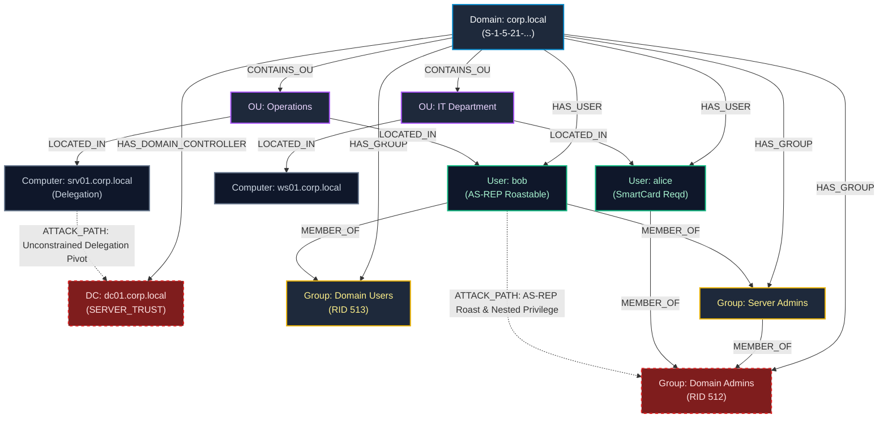

# CyberSecuritySuite — Phase 7C: Advanced Active Directory Enumeration & BloodHound-Compatible Export
## Read-Only Architecture Audit & Technical Design Report

**Project:** CyberSecuritySuite  
**Inspection Type:** Pre-Implementation Architectural Audit & Specification (READ-ONLY)  
**Date:** November 1, 2026  
**Status:** Audit Complete — Standing by for Implementation Approval  
**Production Database:** `storage/data/cybersecuritysuite.db` (`PRAGMA integrity_check: ok`)

---

## 1. Executive Summary

A comprehensive read-only architectural audit of the CyberSecuritySuite Active Directory and LDAP reconnaissance subsystems was performed. The primary objective is to evaluate existing LDAP capabilities, diagnose relationship mapping and topology gaps, specify a schema-compliant BloodHound export engine, and design a read-only attack-path analysis engine without altering the production database schema or creating a disconnected standalone scanner.

### Major Audit Findings:
1. **Core LDAP Protocol Client:** The application contains a robust, pure-Python RFC 4511 BER encoder and decoder (`modules/identity/ldap_client.py`) supporting TCP 389 and LDAPS 636 with strict TLS validation and binary SID/GUID formatters. However, **RFC 2696 Simple Paged Results Control (`1.2.840.113556.1.4.319`) is missing**. Queries against enterprise domains with >1,000 objects are capped or truncated.
2. **Asset Graph Truncation:** While `LDAPLiveEnumerationAdapter` queries users, groups, and OUs, **it never saves Users, Groups, or OUs as `AssetNode` entries in the database!** It only persists `domain_controller`, `domain`, and `computer`.
3. **Missing Identity Relationships:** Group memberships (`MEMBER_OF`), OU memberships (`LOCATED_IN`), domain-to-user mappings (`HAS_USER`), and nested group memberships are **never persisted as `AssetEdge` records**. As a result, the 2D and 3D topology views cannot visualize identity structures or privilege paths.
4. **BloodHound Compatibility:** BloodHound is currently only mentioned as a command-line suggestion (`bloodhound-python ...`) in playbook widgets. **No native BloodHound-compatible JSON or ZIP export engine exists.**
5. **Attack-Path Analysis:** There is currently no graph-based attack path analysis engine to correlate privileged groups, delegation attributes, and roastable accounts.

---

## 2. Feature Gap Matrix (Existing vs. Missing)

| Capability / Feature | Baseline Status | Existing Implementation | Confirmed Gap / Defect | Target Phase 7C Implementation |
| :--- | :---: | :--- | :--- | :--- |
| **Pure-Python LDAP/LDAPS** | **Implemented** | `ReadOnlyLDAPClient` (BER encoder/decoder) | None. Pure standard library, zero external C dependencies. | Preserved without disruption. |
| **TLS Certificate Validation** | **Implemented** | `verify_cert=True` by default with hostname check | Insecure lab mode requires explicit operator opt-in. | Preserved. |
| **LDAP Filter Escaping** | **Implemented** | `escape_filter_value` (RFC 4515) | Backslash, asterisks, parentheses, nulls escaped. | Preserved. |
| **Binary SID & GUID Parsing** | **Implemented** | `format_sid()`, `format_guid()` | Decodes raw AD binary bytes into standard strings. | Request `objectSid` and `objectGUID` across all object queries. |
| **RootDSE Enumeration** | **Implemented** | Search base `""` scope `BASE` | Extracts default naming context, DC hostname, server name. | Extended to discover naming contexts and GC servers. |
| **LDAP Paging (RFC 2696)** | **Missing** | None | Stops on `RESULT_SIZE_LIMIT_EXCEEDED`; capped at 1,000 objects. | Implement RFC 2696 Simple Paged Results Control (`1.2.840.113556.1.4.319`). |
| **Domain Controller Discovery** | **Partial** | Search UAC bit 8192 | Only finds DCs with server trust accounts; misses site topology. | Multi-method discovery (RootDSE, naming context, OU=Domain Controllers). |
| **User Account Enumeration** | **Partial** | `(objectCategory=person)(objectClass=user)` | Queries standard attributes, but misses `objectSid`, `objectGUID`, SPNs. | Add `objectSid`, `objectGUID`, and `servicePrincipalName` attributes. |
| **UAC Bitmask Analysis** | **Implemented** | `_analyze_uac_flags()` | Detects `DONT_REQ_PREAUTH`, `DONT_EXPIRE_PASSWORD`, `PASSWD_NOTREQD`. | Add `TRUSTED_FOR_DELEGATION` and `TRUSTED_TO_AUTH_FOR_DELEGATION`. |
| **Group & Membership Recon** | **Partial** | `(objectClass=group)` | Gathers `member` DNs, but never maps or resolves nested memberships. | Recursive nested group membership expansion and SID correlation. |
| **Computer & OS Recon** | **Implemented** | `(objectClass=computer)` | Extracts DNS hostnames, OS, OS version, creation date. | Correlate computer SIDs and primary group relationships. |
| **Organizational Units (OUs)** | **Partial** | `(objectClass=organizationalUnit)` | Gathers OU names and DNs, but never links to contained computers/users. | Parse parent-child DN containment hierarchy. |
| **Password Policy Audit** | **Implemented** | Root DN policy attributes | Evaluates length, complexity, lockout threshold. | Add detection for Fine-Grained Password Policies (PSOs). |
| **AssetNode Persistence** | **Broken** | `synchronize_to_database()` | **Users, Groups, and OUs are omitted from `AssetNode` persistence.** | Ingest `user`, `group`, and `ou` as native `AssetNode` records. |
| **AssetEdge Persistence** | **Broken** | `synchronize_to_database()` | **`MEMBER_OF`, `LOCATED_IN`, `CONTAINS` edges are omitted.** | Ingest full identity graph relationships into `AssetEdge`. |
| **Scope Authorization Guard** | **Implemented** | `ScopeAuthorizationService` | Dual IPv4/IPv6 pre-flight check, fail-closed, pinned socket IP. | Preserved. |
| **BloodHound Data Export** | **Missing** | None (only CLI command template) | No native JSON/ZIP generation for BloodHound CE / v4/v5 schema. | Build pure-Python schema-compliant BloodHound export engine. |
| **BloodHound Dry-Run Validator** | **Missing** | None | Cannot verify export integrity before distribution. | Implement in-memory JSON schema validator. |
| **Provenance Manifest** | **Missing** | None | No cryptographic linkage between export and source evidence. | Generate `manifest.json` with source evidence SHA-256 and timestamps. |
| **Attack-Path Analysis Engine** | **Missing** | None | No path correlation between users, groups, and Domain Admins. | Read-only BFS/DFS graph analysis engine finding shortest privilege paths. |

---

## 3. Active Directory Data Model & Relationship Diagram



---

## 4. BloodHound Community Edition Schema Compatibility Assessment

BloodHound Community Edition (CE) and legacy BloodHound v4/v5 consume standardized JSON data files packaged individually or compressed into a `.zip` archive.

### A. Supported BloodHound JSON Structure
Every export file must follow this exact envelope format:
```json
{
  "data": [ ... ],
  "meta": {
    "methods": 0,
    "type": "<domains|users|groups|computers|ous>",
    "count": 0,
    "version": 5
  }
}
```

### B. Required Object Properties per File:
1. **`domains.json` (`type: "domains"`):**
   - `ObjectIdentifier`: Domain SID (e.g., `S-1-5-21-392817281-291827182-192819281`)
   - `Properties`: `name` (`CORP.LOCAL`), `domain` (`CORP.LOCAL`), `distinguishedname`, `functionallevel`, `collected: true`
   - `ChildObjects`: Array of contained OUs, Users, Computers
2. **`users.json` (`type: "users"`):**
   - `ObjectIdentifier`: User SID (e.g., `S-1-5-21-...-1104`)
   - `Properties`:
     - `name`: Full principal name in uppercase (`JDOE@CORP.LOCAL`)
     - `samaccountname`: `jdoe`
     - `distinguishedname`: `CN=John Doe,OU=IT,DC=corp,DC=local`
     - `enabled`: boolean (`!(uac & 2)`)
     - `dontreqpreauth`: boolean (`bool(uac & 0x400000)`)
     - `passwordnotreqd`: boolean (`bool(uac & 0x20)`)
     - `pwdneverexpires`: boolean (`bool(uac & 0x10000)`)
     - `admincount`: boolean (`adminCount == 1`)
     - `serviceprincipalnames`: array of SPN strings
     - `description`, `email`, `displayname`
   - `PrimaryGroupSID`: Domain Users SID (typically `...-513`)
   - `Aces`: Array of explicit access control entries (only if collected)
3. **`groups.json` (`type: "groups"`):**
   - `ObjectIdentifier`: Group SID (e.g., `S-1-5-21-...-512`)
   - `Properties`: `name` (`DOMAIN ADMINS@CORP.LOCAL`), `admincount: true`, `distinguishedname`
   - `Members`: Array of `{"ObjectIdentifier": "<SID>", "ObjectType": "<User|Group|Computer>"}`
4. **`computers.json` (`type: "computers"`):**
   - `ObjectIdentifier`: Computer SID (e.g., `S-1-5-21-...-1002`)
   - `Properties`: `name` (`WS01.CORP.LOCAL`), `operatingsystem`, `enabled: true`, `haslaps: false`
   - `PrimaryGroupSID`: Domain Computers SID (`...-515`)
5. **`ous.json` (`type: "ous"`):**
   - `ObjectIdentifier`: Object GUID (formatted UUID)
   - `Properties`: `name` (`IT DEPARTMENT@CORP.LOCAL`), `distinguishedname`
   - `ChildObjects`: Array of child OUs and contained object identifiers

### C. Strict Anti-Hallucination & Evidence Rules:
- **No Inferred High-Privilege ACLs:** Unless explicit ACL permissions (DACL) are fetched over LDAP, edges like `GenericAll`, `WriteDacl`, and `DCSync` will **not** be fabricated.
- **Evidence Provenance Manifest (`manifest.json`):** Export archives will include a separate manifest detailing:
  - Source Tool: `CyberSecuritySuite Phase 7C`
  - Collection Timestamp (UTC ISO-8601)
  - Target Domain Controller & Port
  - Evidence File SHA-256 Hash
  - Object Counts & Status Flags

---

## 5. Read-Only Attack Path Analysis Engine Design

### A. Graph Model
The attack path analysis engine operates in-memory over directed graph representations of `AssetNode` and `AssetEdge`.

### B. Path Search Algorithms:
1. **Shortest Path to High-Privilege Targets (BFS):**
   - Targets: `Domain Admins`, `Enterprise Admins`, `Administrators`, `Account Operators`, `Domain Controllers`.
   - Traverses `MEMBER_OF` and nested group memberships backward from unprivileged users to identify transitive membership chains.
2. **AS-REP Roasting Path Identifier:**
   - Filters users with `dont_req_preauth=True` and `is_disabled=False`.
   - Evaluates whether the roastable user has direct or nested membership in privileged groups.
   - Calculates exposure score:
     - `High Risk`: Roastable user is in a Privileged Group.
     - `Medium Risk`: Roastable standard user.
3. **Unconstrained Delegation Exposure:**
   - Filters computers or service accounts with `TRUSTED_FOR_DELEGATION`.
   - Flags potential TGT harvesting if compromised.
4. **Weak Password Policy Path:**
   - Correlates low lockout threshold (or 0) with password-not-required accounts.

### C. Path Telemetry Display Schema:
```json
{
  "path_id": "AP-001",
  "name": "Transitive Path to Domain Admins via Server Admins",
  "severity": "CRITICAL",
  "hops": [
    {"source": "bob", "relation": "MEMBER_OF", "target": "Server Admins"},
    {"source": "Server Admins", "relation": "MEMBER_OF", "target": "Domain Admins"}
  ],
  "starting_exposure": "AS-REP Roastable Account (bob)",
  "terminal_target": "Domain Admins (High-Privilege Domain Group)",
  "evidence_id": 42,
  "confidence": 1.0,
  "mitigation": "Disable 'Do not require Kerberos preauthentication' on 'bob' and remove 'Server Admins' from 'Domain Admins'."
}
```

---

## 6. GUI Integration Plan

The existing Active Directory interface in `desktop/views/active_directory_view.py` and `desktop/widgets/ad_ldap_enumerator_widget.py` will be cleanly extended:

1. **Results Preview Tabs Extension:**
   - Add **"👥 Users Inventory"** (with SID, UAC flags, SPNs).
   - Add **"🛡️ Groups Inventory"** (with nested member counts and admin flags).
   - Add **"📁 Organizational Units"** (showing hierarchy and object counts).
   - Add **"🕸️ AD Identity & Attack Paths"** (interactive visual inspection of privilege chains).
2. **BloodHound Export Interface:**
   - Add **"🐕 Export BloodHound Data"** button to the bottom action bar.
   - Opens export dialog with options:
     - Output format: ZIP package vs individual JSON files.
     - Target schema: BloodHound CE v5.
     - Include Provenance Manifest.
     - Dry-run validation check.
3. **Synchronization & Topology Feed:**
   - Enhance `synchronize_to_database()` to persist all discovered Active Directory assets into `AssetNode` and `AssetEdge` tables.
   - Automatically broadcast `project_data_updated` so the 2D Network Map View and 3D WebGL Terrain render the domain identity nodes.

---

## 7. Security Risk Assessment & Operational Controls

| Identified Operational Risk | Severity | Mitigation Strategy |
| :--- | :---: | :--- |
| **Active Directory Modification** | Critical | Client enforces strictly read-only LDAP operations (Bind, Search, Unbind). No Add, Modify, Delete, or Password operations exist. |
| **Out-of-Scope DC Probing** | High | Pre-flight DNS resolution of all IPv4 and IPv6 addresses; fail-closed rejection of any out-of-scope or excluded target. |
| **Active Attack Execution** | High | The platform performs passive/read-only enumeration. No automated Kerberoasting hash extraction, password spraying, or cracking is initiated. |
| **Credential & Secret Exposure** | High | `SENSITIVE_ATTRIBUTES` blacklists `unicodePwd`, `ntPwdHash`, `userPassword`, etc. All logs redact credentials. |
| **DC Resource Exhaustion (DoS)** | Medium | Paging with small page sizes (500), query timeouts (10-15s), and client-side message size ceiling (16MB). |
| **DNS Rebinding Attacks** | Medium | TCP socket connection is pinned directly to the pre-verified IP while preserving `server_hostname` for TLS SNI. |
| **False-Positive Attack Paths** | Low | Attack paths require 100% empirical evidence (exact LDAP `member` DNs and SIDs). Inferred or unverified ACLs are excluded. |

---

## 8. Comprehensive Test Plan

A dedicated automated test suite (`tests/test_ad_advanced_enumeration_bloodhound.py`) will verify:
1. **RFC 2696 Simple Paged Results Control:**
   - Search request BER encoding with Control OID `1.2.840.113556.1.4.319`.
   - Multi-page iteration with cookie handling.
   - Graceful termination when cookie is empty.
2. **Binary SID & GUID Formatting:**
   - Binary SID unpacking (`S-1-5-21-...`) and GUID UUID formatting.
3. **Complete AssetNode & Edge Synchronization:**
   - Ingestion of users, groups, computers, and OUs into isolated temporary DB.
   - Verification of `HAS_USER`, `HAS_GROUP`, `MEMBER_OF`, `LOCATED_IN`, `CONTAINS_OU` edges.
   - Idempotency test (repeated runs do not generate duplicate nodes or edges).
4. **BloodHound Community Edition Schema Validation:**
   - Verification of JSON envelopes (`domains.json`, `users.json`, `groups.json`, `computers.json`, `ous.json`).
   - Meta object validation (`version: 5`, `type`, `count`).
   - SIDs and UPPERCASE principal names validation.
   - ZIP file packaging and extraction integrity.
   - Provenance manifest validation with SHA-256 hash matching.
5. **Attack-Path Analysis Engine:**
   - BFS path finding from test user to Domain Admins via nested group.
   - AS-REP roastable privilege correlation.
6. **Scope Authorization & DNS Rebinding Guard:**
   - Verification of out-of-scope DC rejection.

---

## 9. Small Staged Implementation Plan

- **Stage 1 (Pure-Python LDAP Paging Control):** Implement RFC 2696 Paged Results Control in `modules/identity/ldap_client.py`.
- **Stage 2 (Complete AD Asset Graph Ingestion):** Enhance `modules/identity/ldap_adapter.py` to persist Users, Groups, OUs, and `MEMBER_OF` / `LOCATED_IN` edges into `AssetNode` and `AssetEdge`.
- **Stage 3 (BloodHound CE Export Engine):** Create `modules/identity/bloodhound_exporter.py` implementing BloodHound CE v5 JSON/ZIP serialization and provenance manifests.
- **Stage 4 (Read-Only Attack Path Engine):** Create `modules/identity/ad_attack_paths.py` implementing BFS privilege path discovery.
- **Stage 5 (GUI Workspace Integration):** Extend `desktop/widgets/ad_ldap_enumerator_widget.py` with BloodHound export actions, OU previews, and attack path inspection.
- **Stage 6 (Automated Testing & Regressions):** Execute `tests/test_ad_advanced_enumeration_bloodhound.py` and verify full repository test suite.

---

> **Status:** Read-only architecture audit complete. No source code modifications or database operations have been executed during this audit. **Standing by for your explicit approval before beginning source code implementation.**

