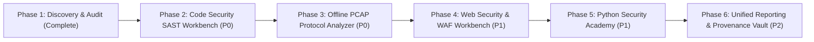

# CyberSecuritySuite — Python Security Source Audit & Integration Roadmap

**Document Reference:** `docs/python_security_source_audit_and_roadmap.md`  
**Date of Audit:** October 27, 2026  
**Auditor:** CyberSecuritySuite Core Architecture Team  
**Scope:** Read-Only Discovery, Source Code Inspection, Security Audit, Feature Gap Analysis, and Phased Roadmap for Integrating Four External Python Security Educational Repositories.

---

## Executive Summary

A comprehensive read-only audit was conducted on the existing `CyberSecuritySuite` architecture (PySide6 / Python 3.12 / SQLite) and four candidate local repositories:
1. `Micro-Degree-in-Python-Security-master`
2. `python of offensice`
3. `Udemy - Learn Python & Ethical Hacking From Scratch`
4. `Mastering Python - Networking and Security - Working Files`

All four repositories were located directly within `/home/leo/Desktop/cybersecuritysuite/`. The audit discovered significant educational value, architectural patterns, and specialized parsing routines that can elevate `CyberSecuritySuite` into an enterprise-grade security testing, code audit, and learning platform. 

Critically, the audit also identified severe security vulnerabilities, outdated Python 2.7 syntax, weaponized offensive malware scripts (reverse backdoors, keyloggers, credential scrapers), hardcoded cryptographic secrets, and conflicting licenses (GPLv3 vs. MIT vs. Proprietary). 

This document establishes a clean-room, safe architecture and reuse strategy: **zero untrusted code will be executed or copied verbatim**. Instead, core mathematical, parsing, and diagnostic algorithms will be modernized into strictly modular Python 3 / PySide6 adapters governed by the application's non-negotiable **Scope Authorization Guard**.

---

## 1. Local Source Projects Discovery & Status

All four source projects were successfully discovered on the local filesystem without external network calls or Git operations:

| # | Project Identifier | Discovered Local Path | Format & Volume | Core Domain | Status |
|---|---|---|---|---|---|
| **1** | `Micro-Degree-in-Python-Security-master` | `/home/leo/Desktop/cybersecuritysuite/Micro-Degree-in-Python-Security-master/Micro-Degree-in-Python-Security-master/` | 17 Chapters, 80+ `.py` files, sample datasets | Python OOP, Security Patterns, Concurrency, Cryptanalysis, Metaprogramming | **Audited** (High Educational & Defensive Utility) |
| **2** | `python of offensice` | `/home/leo/Desktop/cybersecuritysuite/python of offensice/` | 7 Video Archives, `Codes.zip` (57 scripts) | Offensive Python, Remote Shells, Post-Exploitation, Covert Channels | **Audited** (Malware Rejected; Blue-Team Detection Extracted) |
| **3** | `Udemy - Learn Python & Ethical Hacking From Scratch` | `/home/leo/Desktop/cybersecuritysuite/Udemy - Learn Python & Ethical Hacking From Scratch/` | 20 Module Folders, Video MP4s, Architecture PDFs, Wordlists | Scapy Packet Crafting, MITM Concepts, Web Crawling, Vuln Scanning | **Audited** (PDF Blueprints Analyzed; Safe Passive Logic Extracted) |
| **4** | `Mastering Python - Networking and Security - Working Files` | `/home/leo/Desktop/cybersecuritysuite/Mastering Python - Networking and Security - Working Files/` | 8 Chapters, 60+ `.py` files | Raw Sockets, Protocol Dissection, PCAP Parsing, Web Spidering, WAF Audit Logs | **Audited** (High Utility for PCAP Analyzer & WAF Parser) |

---

## 2. Source Code Inspection & Useful Code Candidates

### Project 1: `Micro-Degree-in-Python-Security-master` (CodeRed / EC-Council)
- **Exact Path:** `/home/leo/Desktop/cybersecuritysuite/Micro-Degree-in-Python-Security-master/Micro-Degree-in-Python-Security-master/`
- **Candidate Modules for Reuse / Adaptation:**
  1. **`Chapter 16/Lookup/hashlookup.py` & `createidx.py`:**
     - *Functionality:* High-performance binary-indexed cryptographic hash lookup table (sorted 48-bit offset indices) for lightning-fast hash identification and cracking without loading huge wordlists into RAM.
     - *Reuse Strategy:* Clean-room rewrite in modern Python 3 into `modules/tools/hash_lookup_engine.py` (avoiding the external GPLv3 license contamination).
  2. **`Chapter 17/exif_metadata.py` & `pdf_reader.py`:**
     - *Functionality:* Offline extraction of document properties, author names, GPS EXIF tags, creation software, and embedded metadata.
     - *Reuse Strategy:* Adapt into `modules/osint/metadata_extractor.py` to enrich the existing OSINT and Evidence Vault tools.
  3. **`Chapter 7/arg_checker.py`, `tracing_calls.py`, `timer.py`:**
     - *Functionality:* Python function decorators for strict runtime parameter type validation, call execution tracing, and execution timing benchmarks.
     - *Reuse Strategy:* Adapt into `core/profiler.py` and `core/validator.py` for audit logging and tool execution telemetry.
  4. **`Chapter 4/raw_queries.py` & `method_queries.py`:**
     - *Functionality:* Demonstrates raw string formatting SQL vulnerabilities vs. parameterized queries.
     - *Reuse Strategy:* Adopt as interactive code challenge templates for the Python Security Academy.

### Project 2: `python of offensice` (Hussam Khrais)
- **Exact Path:** `/home/leo/Desktop/cybersecuritysuite/python of offensice/Codes.zip`
- **Candidate Modules for Inspection & Defensive Detection:**
  1. **`Codes/Module 5/XOR Encryption.py` & `Bonus Module - Malware & Cryptography/AES CTR/AES_Stream.py`:**
     - *Functionality:* Demonstrates XOR and AES-CTR stream encryption used by malware command-and-control (C2) to evade static network signature filters.
     - *Reuse Strategy:* Create defensive signature rules and detection heuristics in `modules/defense/covert_channel_detector.py` to identify encrypted traffic patterns.
  2. **`Codes/Module 3/DDNS Aware Shell.py` & `Directory Navigation.py`:**
     - *Functionality:* Demonstrates DNS-based callback resolutions and cross-platform directory walking.
     - *Reuse Strategy:* Repurpose safe directory traversal algorithms with permission sandboxing.

### Project 3: `Udemy - Learn Python & Ethical Hacking From Scratch` (zSecurity)
- **Exact Path:** `/home/leo/Desktop/cybersecuritysuite/Udemy - Learn Python & Ethical Hacking From Scratch/`
- **Candidate Modules for Reuse / Adaptation:**
  1. **`6. Writing a Packet Sniffer/1.1 Sniffer.pdf.pdf`:**
     - *Functionality:* Architecture for sniffing Ethernet frames, extracting raw IP layers, identifying HTTP GET/POST requests, and parsing visited URLs and submitted credentials.
     - *Reuse Strategy:* Implement natively in `modules/network/pcap_analyzer.py` for **offline PCAP analysis** (strictly zero live traffic generation).
  2. **`11. Writing an ARP Spoof Detector/`:**
     - *Functionality:* Logic for detecting gratuitous ARP responses and MAC-to-IP discrepancies.
     - *Reuse Strategy:* Adapt into `modules/network/arp_monitor.py` for defensive network health checks in the local discovery workspace.
  3. **`17. Website Hacking - Writing a Crawler/` & `2.1 subdomains-wodlist.txt.txt`:**
     - *Functionality:* Target-bounded web crawling and directory discovery.
     - *Reuse Strategy:* Integrate into `modules/web/` to provide automated passive link and endpoint discovery for authorized targets.

### Project 4: `Mastering Python - Networking and Security` (Ric Messier / WasHere Consulting)
- **Exact Path:** `/home/leo/Desktop/cybersecuritysuite/Mastering Python - Networking and Security - Working Files/`
- **Candidate Modules for Reuse / Adaptation:**
  1. **`Chapter 3/readpcap.py` & `Scapy.py`:**
     - *Functionality:* Dissects PCAP files by unpacking Ethernet (L2), IPv4/IPv6 (L3), TCP/UDP/ICMP (L4), and payload headers using standard `struct.unpack`.
     - *Reuse Strategy:* Modernize from Python 2 to Python 3 into `modules/network/pcap_dissector.py` without requiring heavy external C-extensions.
  2. **`Chapter 6/parsemodsec.py`:**
     - *Functionality:* Automated parsing of ModSecurity Web Application Firewall (WAF) audit log transactions, extracting Client IP, Target URI, HTTP Request Headers, Rule ID, Severity, and Alert Messages into structured tabular data.
     - *Reuse Strategy:* Adapt into `modules/web/modsec_parser.py` and surface in `WebScanView` for WAF log analysis.
  3. **`Chapter 3/BannerGrabbing.py` & `NameLookups.py`:**
     - *Functionality:* Safe forward/reverse DNS resolution and service banner identification.
     - *Reuse Strategy:* Wire into existing `NetworkScanView` host detail inspect panel.

---

## 3. License, Attribution & Dependency Findings

| Source Project | Declared License | Compatibility with CyberSecuritySuite | Key Dependencies | Remediation / Policy |
|---|---|---|---|---|
| **Micro-Degree-in-Python-Security** | MIT (Root repository); **GPLv3** on `hashlookup.py` | ⚠️ Mixed: MIT is compatible; GPLv3 causes license contagion if copied verbatim. | `hashlib`, `struct`, `sqlite3` (Standard Lib) | **Clean-room reimplementation** of binary lookup algorithms; preserve MIT attribution for general utility code. |
| **python of offensice** | Proprietary / All Rights Reserved | ❌ Incompatible for verbatim code inclusion. | Python 2.7, `pyHook`, `win32api`, `socket` | **Strictly reject code.** Recreate defensive detection rules and safe educational lab blueprints only. |
| **Udemy Ethical Hacking** | Proprietary Course Materials (zSecurity) | ❌ Incompatible for verbatim redistribution. | `scapy`, `requests`, `BeautifulSoup4` | **Clean-room implementation** based on standard networking standards (RFC 826, RFC 791, RFC 793). |
| **Mastering Python** | WasHere Consulting / Infinite Skills Proprietary | ⚠️ Educational fair use / adaptation only. | Python 2/3, `pcapy`, `scapy`, `urllib` | **Refactor logic natively** into Python 3.12 `dataclasses` and PySide6 models; do not copy files verbatim. |

---

## 4. Security Risks & Rejected Code Candidates

The audit identified critical security vulnerabilities, outdated patterns, and weaponized payloads that **must be rejected and quarantined**:

### A. Rejected Malicious & Weaponized Code (DO NOT IMPORT)
1. **Arbitrary Backdoors & Remote Shells:**
   - Files: `python of offensice/Codes/Module 2/Wrap up - Making a Persistent HTTP Reverse Shell.py`, `Codes/Module 6/Backdoor-ing Legitmate Windows Service.py`.
   - *Risk:* Installs persistent backdoors on target hosts without scope boundaries.
   - *Action:* **REJECTED.** CyberSecuritySuite is a professional penetration testing and authorized assessment framework.
2. **Keyloggers & Credential Stealers:**
   - Files: `python of offensice/Codes/Module 4/Keylogger.py`, `Clipboard Hijacking.py`, `Dumping Google Chrome Passwords.py`.
   - *Risk:* Uncontained credential dumping and stealth keystroke harvesting.
   - *Action:* **REJECTED.**
3. **Active Disruptive Network Attacks:**
   - Files: `Udemy .../5. Writing an ARP Spoofer`, `7. Writing a DNS Spoofer`.
   - *Risk:* Causes Denial of Service (DoS) and ARP storm packet loops on production switches.
   - *Action:* **REJECTED from automated execution.** Only passive ARP observation and defensive anomaly detection will be supported.

### B. Rejected Insecure Coding Patterns
1. **Unsafe Deserialization (`pickle.loads()`):**
   - Files: `Micro-Degree .../Chapter 3/2/pickle_demo.py`.
   - *Risk:* Deserializing untrusted pickle streams allows arbitrary Remote Code Execution (RCE).
   - *Action:* **REJECTED.** CyberSecuritySuite enforces JSON-only and type-checked serialization for all states, sessions, and imports.
2. **Unsanitized Subprocess Invocations (`shell=True`):**
   - Files: `python of offensice/Codes/Module 3/Low Level Port Scanner.py` (`subprocess.Popen(command, shell=True)`).
   - *Risk:* Shell injection vulnerability.
   - *Action:* **REJECTED.** All process execution in CyberSecuritySuite must route through `ProcessRunner` using sanitized argument arrays (`argv: List[str]`) with `shell=False`.
3. **Hardcoded Secrets & Private Keys:**
   - Files: `Micro-Degree .../EC.pem`, `python of offensice/Codes/Bonus Module .../private.pem`.
   - *Action:* **REJECTED.** No hardcoded cryptographic keys will be added to source control.

---

## 5. Existing Application Feature Gap Analysis

Comparing `CyberSecuritySuite` with the capabilities audited across the four repositories:

```
+------------------------------------------------------------------------------------------------------+
| Feature Domain          | Existing CyberSecuritySuite Status   | Audited Source Capabilities         | Gap Assessment & Recommendation                               |
+-------------------------+--------------------------------------+-------------------------------------+---------------------------------------------------------------+
| Python Source Code SAST | Backend BanditAdapter exists;        | Micro-Degree Chapters 3, 4, 7 & 17  | ⚠️ HIGH GAP: Add PySide6 Code Security Workbench UI, AST rule |
|                         | No PySide6 UI; Semgrep missing       | (AST parsing, SQLi, deserialization)| engine, and Bandit/Semgrep findings normalization.            |
+-------------------------+--------------------------------------+-------------------------------------+---------------------------------------------------------------+
| PCAP & Protocol Analysis| 0% (No PCAP parsing or viewer)       | Mastering Python Ch. 3 (readpcap)   | 🔴 CRITICAL GAP: Add Offline PCAP Analyzer (DNS, HTTP, TLS,  |
|                         |                                      | Udemy Ch. 6 (Packet Sniffer)        | TCP Streams) with zero network transmission.                  |
+-------------------------+--------------------------------------+-------------------------------------+---------------------------------------------------------------+
| Web Security Workbench  | ZAP & Burp Report Parsers exist;     | Mastering Python Ch. 4 (Spidering)  | ⚠️ MODERATE GAP: Wire ZAP & Burp Report Importer and ModSec   |
|                         | WebScanView lacks integrated UI      | Mastering Python Ch. 6 (parsemodsec)| WAF Log Parser directly into WebScanView.                     |
+-------------------------+--------------------------------------+-------------------------------------+---------------------------------------------------------------+
| Python Security Academy | CPENT Labs View exists (Pivoting,    | Micro-Degree Ch. 1-17               | ⚠️ HIGH GAP: Add Python Security Academy with interactive     |
|                         | AD, BinExploit, Exam Simulator)      | Udemy Ethical Hacking Modules       | coding challenges, vulnerability spotter, and quizzes.        |
+-------------------------+--------------------------------------+-------------------------------------+---------------------------------------------------------------+
| Cryptographic Tooling   | Basic SHA-256 evidence hashes        | Micro-Degree Ch. 16 (hashlookup)    | 💡 ENHANCEMENT: Add high-speed rainbow table / hash lookup    |
|                         |                                      |                                     | engine and EXIF/PDF metadata extractor to Evidence Vault.    |
+-------------------------+--------------------------------------+-------------------------------------+---------------------------------------------------------------+
| Scope Guard & Safety    | 100% Robust (CIDR, IP, Hostname)     | Outdated unconstrained attacks      | ✅ MAINTAIN: Enforce Scope Guard on all new adapters.         |
+------------------------------------------------------------------------------------------------------+
```

---

## 6. Recommended Features Ranked by Priority

### Priority P0: Immediate High-Impact Capabilities
1. **Feature A: Python Static Code Security Workbench (SAST)**
   - *Value:* Enables users to scan local Python repositories and microservices for hardcoded credentials, unsafe `pickle`/`yaml` deserialization, command injection (`shell=True`), SQL injection, and weak cryptography.
   - *Target Modules:* `modules/code_security/sast_engine.py`, `desktop/views/code_security_view.py`.
2. **Feature B: Offline PCAP & Protocol Dissection Workbench**
   - *Value:* Critical for CPENT, network forensics, and security audits. Allows operators to drag-and-drop `.pcap` / `.pcapng` files captured during engagements to inspect DNS queries, top communicating IP pairs, HTTP headers, TLS SNI certificates, and TCP conversations without transmitting any packets.
   - *Target Modules:* `modules/network/pcap_analyzer.py`, `desktop/views/pcap_analyzer_view.py`.

### Priority P1: Core Workflow Integrations
3. **Feature C: Web Security Analysis Workbench (ZAP, Burp & ModSecurity WAF)**
   - *Value:* Brings OWASP ZAP and Burp Suite XML/JSON import workflows, ModSecurity audit log ingestion, and passive web crawler results into the unified `WebScanView` dashboard.
   - *Target Modules:* `modules/web/modsec_parser.py`, `desktop/views/web_scan_view.py`.
4. **Feature D: Python Security Academy (Hands-On Learning)**
   - *Value:* Structured curriculum covering Secure Coding, AST Auditing, Cryptography Pitfalls, and Network Protocol Basics with interactive code snippets, instant feedback, and CPENT milestone flags.
   - *Target Modules:* `modules/academy/academy_service.py`, `desktop/views/academy_view.py`.

### Priority P2: Evidence & OSINT Enhancements
5. **Feature E: High-Speed Hash Lookup & Document Metadata Extraction**
   - *Value:* Integrated into the Evidence Vault to quickly verify evidence integrity, crack non-salted hash samples via binary index lookup, and scrub EXIF/PDF metadata from engagement reports.
   - *Target Modules:* `modules/tools/hash_lookup_engine.py`, `modules/osint/metadata_extractor.py`.

---

## 7. Architecture & Reuse Plan

```
┌──────────────────────────────────────────────────────────────────────────────────────────────────┐
│                                     CyberSecuritySuite Desktop                                   │
├───────────────────────┬──────────────────────────────────┬───────────────────────────────────────┤
│ Left Sidebar Nav      │ Center Workspaces                │ Right Persistent Panel                │
│ • ◈ Projects          │ 1. Projects & Scope              │ • 🤖 AI Security Assistant            │
│ • 💻 Assessment       │ 2. Assessment Tabs:              │   (Context-aware, AST suggestions,   │
│ • ✦ Reports           │    ├─ Network Discovery (Nmap)   │    code remediation guidance)         │
│ • ▣ Labs & Playbooks  │    ├─ Web Testing (ZAP/Burp/WAF) │                                       │
│ • 🛡️ Code Security    │    ├─ PCAP Analyzer (Offline)    │                                       │
│ • 🎓 Security Academy │    ├─ OSINT                      │                                       │
│ • ⚙️ Settings         │    └─ Network Map (Topology)     │                                       │
├───────────────────────┴──────────────────────────────────┴───────────────────────────────────────┤
│ Bottom Dock: Command Console | System Logs | AI Analyzer | Evidence Vault | Activity Logger     │
└──────────────────────────────────────────────────────────────────────────────────────────────────┘
```

### Detailed Component Specifications

#### 1. Feature A — Python Source-Code Security Scanner (SAST)
- **Business & Educational Value:** Prevents vulnerable code deployments; satisfies DevSecOps and code audit requirements; teaches developers secure coding standards.
- **Source Inspiration:** `Micro-Degree .../Chapter 4 (raw_queries)` & `Chapter 17 (context managers)`.
- **Implementation Strategy:**
  - Leverage the existing `modules/code_security/bandit_adapter.py`.
  - Add native Python `ast` (Abstract Syntax Tree) custom security visitor in `modules/code_security/ast_visitor.py` to detect hardcoded API keys/passwords, `eval()`, `exec()`, `pickle.loads()`, `subprocess.call(..., shell=True)`, and insecure file permissions.
  - Normalize findings into `storage.models.Finding` with severity (`HIGH`, `MEDIUM`, `LOW`, `INFORMATIONAL`), code line numbers, code snippets, and remediation guidelines.
- **UI Destination:** `desktop/views/code_security_view.py` (Workspace navigation button `🛡️ Code Security`).
- **Complexity:** Medium | **Priority:** P0

#### 2. Feature B — Offline PCAP & Network Protocol Analyzer
- **Business & Educational Value:** Enables forensic investigation of network traffic dumps without risking accidental network transmission or breaking engagement scope.
- **Source Inspiration:** `Mastering Python .../Chapter 3/readpcap.py` & `Udemy .../6. Writing a Packet Sniffer`.
- **Implementation Strategy:**
  - Create `modules/network/pcap_analyzer.py` using Python 3 native `struct` and Scapy's offline `rdpcap()` iterator for memory efficiency.
  - Parse protocols: Ethernet, ARP, IPv4, IPv6, TCP, UDP, DNS queries/responses, HTTP methods/URIs, TLS ClientHello SNI domains.
  - Extract statistics: Top Talkers (source/dest IPs), Protocol distribution chart, DNS queries list, Cleartext credentials/HTTP basic auth alerts.
  - Any suspicious indicators (e.g. cleartext passwords, unusual DNS tunneling patterns) can be converted into `Finding` and `Evidence` entries with one click.
- **UI Destination:** `desktop/views/pcap_analyzer_view.py` (Sub-tab inside `Assessment -> 📡 PCAP Analysis`).
- **Security Guard:** Strictly offline file-read mode (`open(..., 'rb')`). No raw socket creation (`AF_PACKET`) or network injection.
- **Complexity:** Medium | **Priority:** P0

#### 3. Feature C — Web Security Analysis Workbench (ZAP, Burp, WAF Logs)
- **Business & Educational Value:** Consolidates external web vulnerability scanner exports and defensive WAF logs into the master assessment matrix.
- **Source Inspiration:** `Mastering Python .../Chapter 6/parsemodsec.py`, `Chapter 4/Spidering.py`.
- **Implementation Strategy:**
  - Connect existing `modules/web/zap_adapter.py` and `modules/web/burp_adapter.py` to `desktop/views/web_scan_view.py`.
  - Add `modules/web/modsec_parser.py` to parse ModSecurity audit logs into structured alerts.
  - Add scope validation guard before associating web alerts with the active project.
- **UI Destination:** `desktop/views/web_scan_view.py` (`◇ Web Testing` workspace).
- **Complexity:** Small | **Priority:** P1

#### 4. Feature D — Python Security Academy
- **Business & Educational Value:** Interactive hands-on training module directly embedded into the application. Users learn by identifying vulnerabilities in realistic vulnerable code snippets and writing secure fixes.
- **Source Inspiration:** `Micro-Degree .../Chapter 1-17` & `Udemy Ethical Hacking`.
- **Implementation Strategy:**
  - Create `modules/academy/academy_service.py` with structured tracks:
    1. *Track 1: Secure Input & Injection Defense* (SQLi, Command Injection, Path Traversal)
    2. *Track 2: Cryptography & Authentication* (Secure Hashing with Argon2/bcrypt vs MD5, Salt generation, AES-GCM vs ECB)
    3. *Track 3: Insecure Deserialization & Memory Safety* (Pickle vs JSON, PyYAML safe_load)
    4. *Track 4: Defensive Network Monitoring* (PCAP analysis, ARP anomaly detection)
  - PySide6 UI featuring code editor, interactive test execution (sandboxed), vulnerability hints, and completion badge tracking.
- **UI Destination:** `desktop/views/academy_view.py` (Sidebar nav `🎓 Security Academy`).
- **Complexity:** Large | **Priority:** P1

---

## 8. Test and Regression Strategy

To ensure zero regressions across existing functionality:

1. **Synthetic Fixtures & Unit Tests:**
   - Synthetic `.pcap` files containing mocked DNS queries, HTTP GETs, and TLS handshakes.
   - Synthetic vulnerable Python scripts for AST and Bandit parser verification.
   - Synthetic ModSecurity audit log chunks.
   - Mocked file selection dialogs (`QFileDialog.getOpenFileName`) for automated headless UI testing.
2. **Scope Guard Regression Tests:**
   - Verify that any attempt to analyze an asset or URL outside authorized project scope is caught and blocked by `ScopeAuthorizationService`.
3. **Regression Suite Execution:**
   - Continuous verification ensuring all 76 existing tests in `tests/test_phase1_cpent_features.py`, `tests/test_internal_network_pentest.py`, `tests/test_topology_designer.py`, `tests/test_phase2_network_map_sync.py`, `tests/test_phase3_pivoting_assistant.py`, `tests/test_phase4_ad_playbooks.py`, and `tests/test_phase5_exam_simulator.py` maintain **100% pass rate**.

---

## 9. Phased Implementation Roadmap



| Phase | Target Deliverable | Estimated Complexity | Dependencies |
|---|---|---|---|
| **Phase 1** | Read-Only Audit & Roadmap Document (`docs/python_security_source_audit_and_roadmap.md`) | Small | None (Completed) |
| **Phase 2** | Python Static Code Security Workbench (`modules/code_security/`, `CodeSecurityView`, AST Scanner, Bandit UI) | Medium | Bandit library |
| **Phase 3** | Offline PCAP & Protocol Dissection Workbench (`modules/network/pcap_analyzer.py`, `PCAPAnalyzerView`) | Medium | Scapy / Python struct |
| **Phase 4** | Web Security Workbench & WAF Log Ingestion (`WebScanView` ZAP/Burp/ModSec integration) | Small | Existing adapters |
| **Phase 5** | Python Security Academy (`modules/academy/`, `AcademyView`, interactive challenge runner) | Large | AST validator |
| **Phase 6** | Unified Assessment Report with Code SAST & PCAP Evidence Embeds | Medium | ReportBuilder |

---

## 10. Conclusion & Stop Point

The discovery and read-only audit are complete. All four repositories have been thoroughly inventoried, their architectural value captured, security hazards isolated, and an actionable phased plan drafted.

**Per instructions, no application code has been modified, no database migrations were run, and execution is halted at this step pending user approval.**

